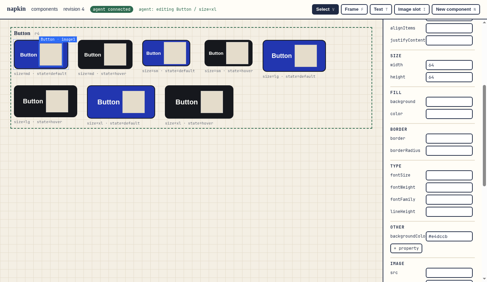

# napkin

From napkin sketch to real components: a Paper-like design canvas tuned for components, that agents and people edit together.

Early days. The contract is in [INTENT.md](INTENT.md); how it fits the other projects is in [STACK.md](STACK.md).

## First build (2026-10-20)
A local canvas for **real React components**. Every `*.tsx` in a folder is a component in the napkin dialect ([decision 0003](docs/decisions/0003-tsx-dialect.md)): plain React with typed props, a `base` style per element and `variants` that hold only overrides. Any React app imports these files as they are. You on the canvas and your agents over MCP edit the same files live, and edits from a text editor, `git restore` or a branch switch show up too.



**The proving demo** (`npm run demo`, [log](docs/demo/demo-log.txt), [diff](docs/demo/demo-diff.txt)): David and an agent edit one Button at once. David changes the base radius in the panel and draws an icon slot with `I`; the agent calls `add_variant` for an `xl` size. Both land in `Button.tsx` (15 lines added, 2 removed), the canvas shows "agent: editing Button / size=xl" while it works, and a separate plain React app ([examples/consumer-app](examples/consumer-app/)) renders all 8 Buttons with both changes.

```console
npm test                              # 52 tests: format, edit path, MCP, live sync, rendering, panel, drawing, the demo
npm run demo                          # the proving demo in headless Chromium; writes docs/demo/
npm start                             # canvas at http://127.0.0.1:4810/ on a temp copy of fixtures/ (the repo is not edited)
node src/server.js --dir components --port 4810    # your own folder of components, edited in place
NAPKIN_URL=http://127.0.0.1:4810/ npm run mcp      # MCP for an agent: list_components, read_component, apply_edits (dryRun), add_variant, create_component
node examples/consumer-app/build.mjs <components dir> [out]   # a plain React app that imports Button
```
**On the canvas:**
- Click an element to select it.
- The panel edits styles on the **Base** or on **This variant**. An override shows a dot and a "Reset to base" button.
- The panel also edits text, "Make setting" (text becomes a prop), props and defaults, and variant axes and values.
- Tools: `V` select, `F` frame (drag to size), `T` text, `I` image slot, `N` new component.
- Delete removes the selected element, and Alt+↑/↓ reorders it.

A file napkin can't read fully opens read-only with a badge, and napkin never rewrites it.

**Not in this build:** a tokens panel, opening other repos' components, Figma/HTML import, undo inside napkin (use git), hosting. See FEATURES.md.

Contract the tests rely on: [test/CONTRACT.md](test/CONTRACT.md). Decisions: [docs/decisions/](docs/decisions/).
