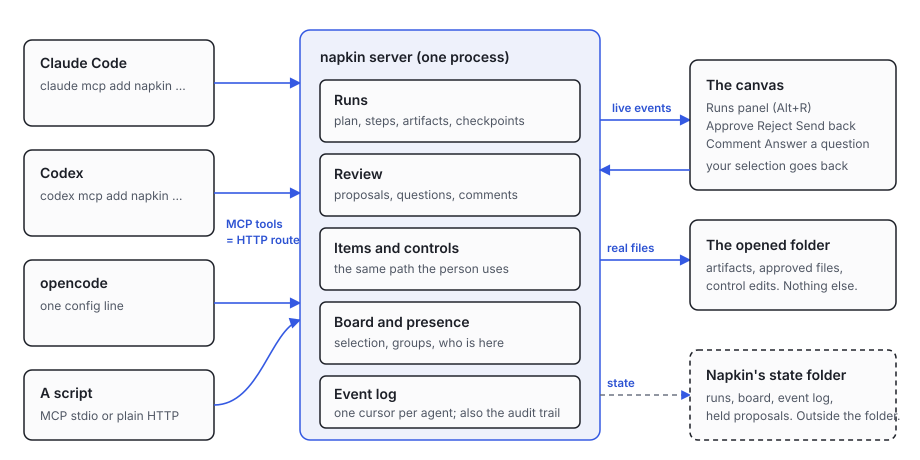

# Agents: runs, review and the shared surface

How any harness (Claude Code, Codex, opencode, a script) works with napkin. Every tool below is one HTTP route and
one MCP tool; the arguments of the tool are the body of the route, with `run`, `item`, `proposal` and `question` naming
the path parameter. Source: `src/agents/` (store, routes, board, tools) and `public/canvas/run-panel.js`.

## Connect

See "One line per harness" in the README. An agent's name is `NAPKIN_AGENT`. For HTTP, `POST /api/session { as }`
returns a token to send as `Authorization: Bearer <token>`. Reading needs no token; writing needs one. `napkin.json` can
limit a name to `read`, `propose` or `write` (decision 0005). A `propose` agent can start runs, post steps, ask and
propose, and a file it would add becomes a proposal instead.

## What happens where

Runs, proposals, questions, the board and the event log live in napkin's state directory, outside the opened folder.
The folder only ever receives real files: artifacts an agent places, proposals you approve, control edits.

## The tools

| Tool | Route | What it does |
|---|---|---|
| `list_items` | `GET /api/items` | Every file in the folder as an item (`kind` filters). |
| `read_item` | `GET /api/read?item&offset&length&encoding` | Text as utf8, binary as base64, windowed. |
| `get_controls` | `GET /api/controls/<id>` | Every control the item panel shows, with `revision`. |
| `set_control` | `POST /api/control` | Same path the person uses. A stale `baseRevision` fails with `stale revision` and `currentRevision`. |
| `undo` | `POST /api/undo` | Undo your own latest control change. |
| `place_item` | `POST /api/item-layout` | Move a card. |
| `get_board` / `set_board` | `GET\|POST /api/board` | Selection, viewport, groups, arrangement, saved views; `runs` lists one section per run. |
| `start_run` | `POST /api/runs` | A plan of steps: `[{ id, label }]`. |
| `list_runs`, `get_run` | `GET /api/runs[/<id>]` | Progress; or plan, steps, artifacts, questions, proposals, checkpoints. |
| `add_run_step` | `POST /api/runs/<id>/steps` | Set a step's status, or add a step. |
| `add_artifact` | `POST /api/runs/<id>/artifacts` | Write a real file (utf8 or base64) into the run's section. 409 when the path holds other bytes, unless `overwrite`. |
| `set_run_status` | `POST /api/runs/<id>/status` | running, paused, complete, failed, cancelled. |
| `checkpoint_run`, `resume_run` | `POST /api/runs/<id>/checkpoint`, `/resume` | A checkpoint records where you are; resume returns the next unfinished step, what is open, and what you answered since. |
| `propose` | `POST /api/runs/<id>/proposals` or `/api/proposals/file` | A file, or an instrument change (`item`, `control`, `value`). Nothing is written until the person approves. |
| `resolve_proposal` | `POST /api/review/<id>` | `accepted`, `rejected`, `sent-back`, `comment`. You cannot answer your own. |
| `ask_question`, `wait_for_answer`, `answer_question` | `POST /api/questions`, `GET /api/questions/<id>?wait=ms`, `POST /api/questions/<id>/answer` | A question that shows on the canvas; `waitMs` waits for the answer. |
| `list_review` | `GET /api/review` | What waits for the person. |
| `read_events` | `GET /api/event-log` | What happened since you last read (a cursor per agent name, kept across restarts). `since`, `waitMs`, `run`, `types`. |
| `get_agents`, `get_audit` | `GET /api/agents`, `/api/audit` | Who is here and what they are doing; every write, with who and when. |

`GET /api/events` is the live stream (server-sent events). `?since=<seq>` replays what a reconnecting client missed.
Run events: `run-started`, `run-step`, `run-artifact`, `run-proposal`, `run-proposal-resolved`,
`run-proposal-comment`, `run-question`, `run-question-answered`, `run-checkpoint`, `run-resumed`, `run-status`,
`board-set`. Each has `seq`, `at` and `by`. The answer to a proposal is one event with the proposal `id`, `outcome`
and `comment`; the answer to a question has the question `id` and the exact `answer`.

## A run, step by step

1. `start_run { name, plan }` returns `{ id }`. The person sees the run, its steps and your presence.
2. `add_run_step { run, id, status: "running" }`, do the work, then `status: "complete"`.
3. `add_artifact { run, path, content, encoding, step }` puts the file in the folder; it appears on the canvas at once.
4. When a change needs a decision: `propose`. Read the result with `read_events` (an `accepted` proposal is already
   on disk and is listed as an artifact of the run; `sent-back` carries the person's comment, and you `propose`
   again with `replaces`).
5. When you need an answer: `ask_question`, then `wait_for_answer`.
6. `checkpoint_run` before anything long. After an interruption or a restart: `resume_run`.

Errors end with "Next:" and say what to do. `stale revision` always means someone else changed it first: read again,
retry.

## Safety

- Artifact paths are relative and inside the folder: no `..`, no absolute paths, no hidden names, and none of the
  skipped folders (`node_modules`, `dist`, `build`, `out`, ...). Links cannot lead out.
- A path that already holds different bytes is never replaced silently. An accepted proposal for a file that changed
  since it was proposed is refused and stays open.
- Nobody reviews their own work.
- Writers are serialized by the one server process; revisions on controls and the board turn a lost race into a 409.

## On the canvas

The **Runs** panel (bottom left; Alt+R). It lists the agents that are here and what each is doing, a "Waiting for you"
queue and each run's plan with live status and its files (click one to select its card). Cards made by a run carry
`data-run`. The person's selection and viewport are posted to `/api/board`, so `get_board` shows what they see.

Review queue keys (focus a card): `j`/`k` or arrows move, `a` approve, `x` reject, `s` send back, `c` note (Enter posts
it as a comment; the note goes with `a`, `x`, `s`), `1` to `9` pick a question's option, Escape returns to the canvas.
The commands (Open runs, Approve, Reject, Send back, Comment, Next review) are handed to the command registry through
`ctx.registerCommands(list)` when it exists; otherwise they wait in `window.napkinCommandQueue`.

## Demo

`node tools/agent-demo.mjs <canvas address>` runs a 13-step plan: six kinds of file, a group, a tuned control, two
proposals, a question, a checkpoint and a resume. `--auto-answer` answers for you, for unattended checks.

## Tests and measure

`node --test test/agents3/` (server, MCP, and a browser run of the review queue by keyboard) and
`node bench/agents3.js` (the 30-step script over MCP only).

## Round 2 changes

- Board groups: `set_board` accepts `addGroups`, `removeGroups` and `moveItems`, which apply to the current list and never drop another writer's groups. Replacing the whole `groups` list needs `baseRevision` once any group exists (otherwise a 409 says so).
- Saved views: `addViews` and `removeViews` never drop another writer's views. Replacing `views` with a list that leaves out an existing view needs `baseRevision` (409 otherwise).
- On the canvas each run is a region with a progress header; groups whose files belong to a run are drawn inside it, and `Arrange by run` keeps them as blocks inside the run. The view follows the newest run until you move it yourself; `Fit to run` (palette) frames it again.
- Review: text proposals show the changed lines on the card; `D` (or the Full diff button) opens the complete diff with line numbers, `N`/`P` jump between changes, and `A`/`X`/`S` decide from inside it.
- The runs panel is docked along the bottom and the canvas shrinks to make room. Every file a run made is listed with its folder. Groups and runs are drawn as labelled regions behind their cards, and "Arrange by run" (command, or `set_board` with `arrange: { by: "run" }`) packs each section together.
- Direct control writes (`POST /api/control`) appear in the audit as `item-control` events and show their writer as present.
- The MCP client refreshes its session on any identity refusal, in either letter case, so a restart is invisible to a connected agent.
