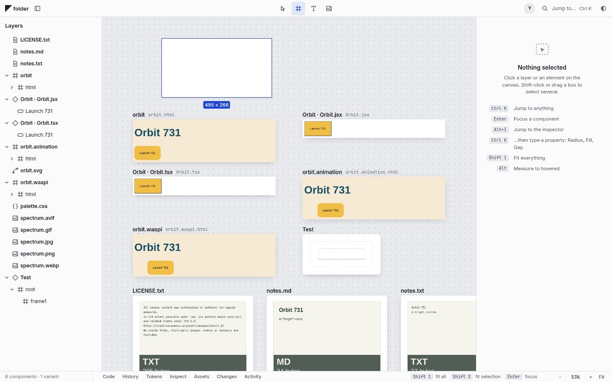
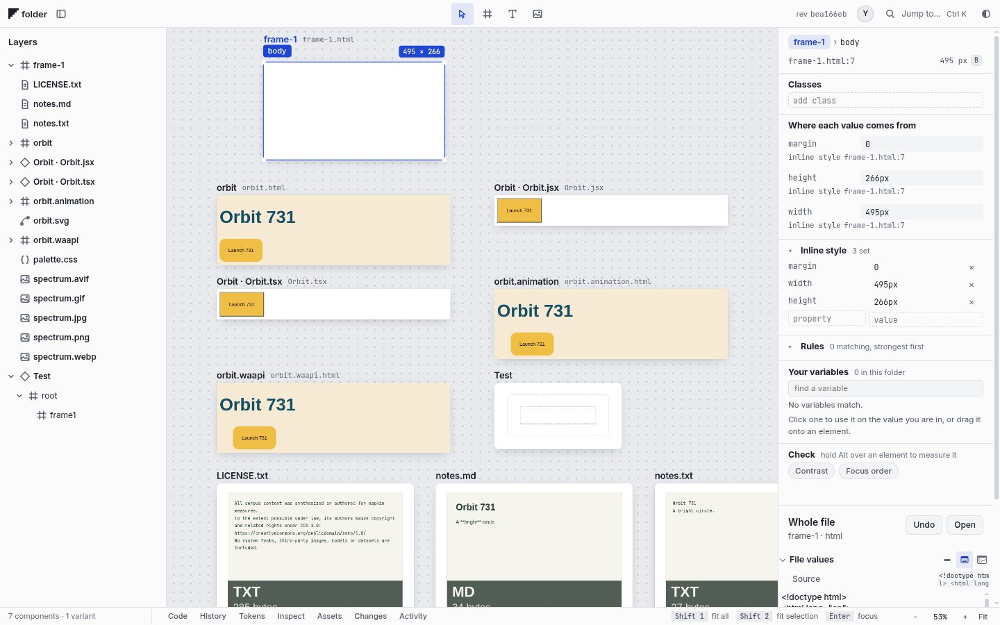
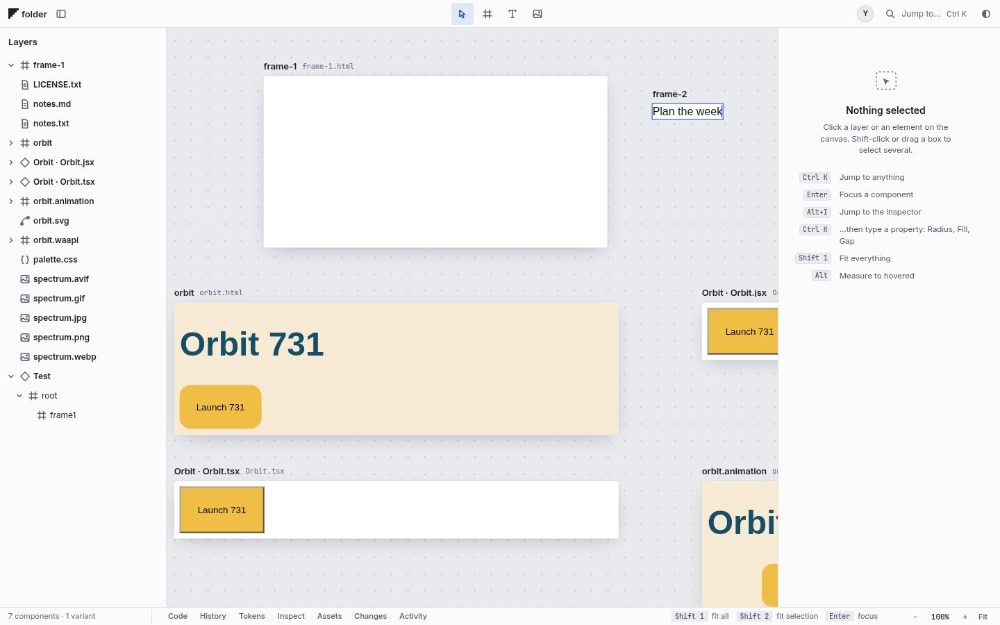
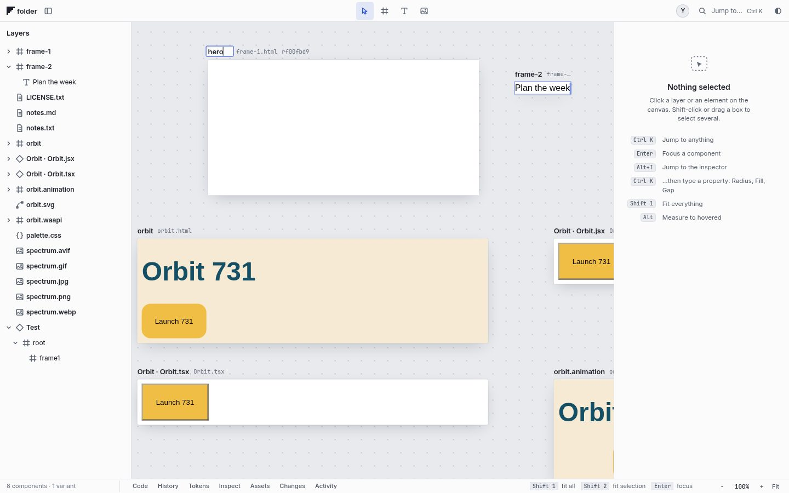
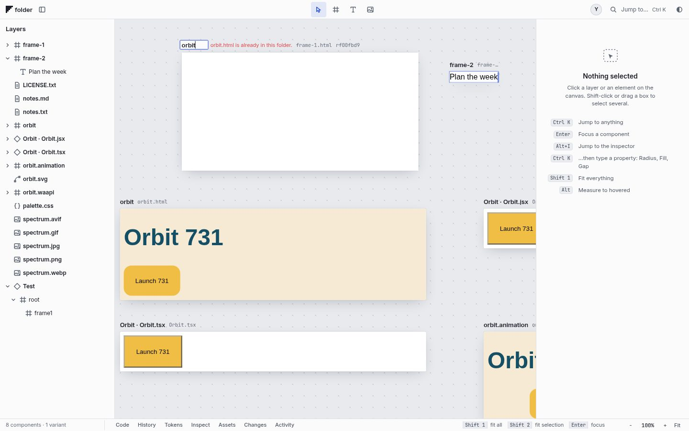
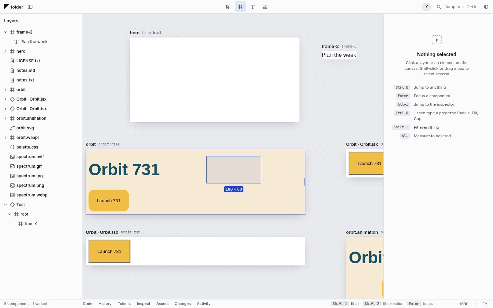

# Basics pass 2: create on the canvas

Pick a tool, draw, and the thing is there. Frame (F), Text (T) and Image (I) arm from the keyboard or the top bar. The cursor shows the armed tool. Escape disarms, and after one use the tool goes back to Select. Rules: `standards.md` sections 2, 3 and 4.

| | |
|---|---|
|  |  |
|  |  |
|  |  |

## On empty canvas: a new file

- **Frame**
  - A click places a 320 x 180 frame at the pointer. A drag draws it to size.
  - Shift makes it square; Alt draws from the centre. The smallest frame is 48 x 32.
  - F then Enter places the default frame in the middle of the view.
- **Text**
  - A click gives text that grows as you type; a drag gives a fixed width.
  - Enter is a new line. Escape, Ctrl+Enter or a click elsewhere commits.
  - The file is written on commit and hugs the text. Text left empty leaves nothing: no card, no file, no undo step.
- **Image**
  - A click gives a 160 x 120 slot, or a drag sizes it, and the file picker opens.
  - Cancel takes the slot away. The picture goes to `assets/` and fills the frame.

The new file is `frame-N.html`, using the lowest free N. The card appears straight away and the file follows. The card sits exactly where it was drawn: its position is napkin's layout state (`layout.json` in the state folder), never the HTML.

### The template

```html
<!doctype html>
<html lang="en">
<head>
<meta charset="utf-8">
<title>frame-1</title>
</head>
<body style="margin: 0; width: 320px; height: 180px"></body>
</html>
```

The template is plain HTML: no stylesheet, no script, and nothing that names napkin. The body carries the drawn size. Text frames have no height, so the body hugs the paragraph:

```html
<body style="margin: 0; width: 102px">
<p style="margin: 0; font: 16px/1.4 system-ui, sans-serif">Plan the week</p>
</body>
```

## Inside an HTML frame: an element

The same gestures, outline and readout insert an element with one edit, and select it afterwards.

- **Where it goes**
  - In the body, or in any positioned element, the element is placed where it was drawn (`position: absolute`).
  - In any other container it joins the flow at the end.
  - On text or an image it goes just after that element.
- **What it is**
  - Frame: a `div` with a light fill (`#f4f4f5`) so it can be seen.
  - Text: a `p`.
  - Image: an `img`.

## Undo and rename

- One undo removes the card and the file together. Redo brings both back. This goes through the server's per-file history (`POST /api/frames`, `DELETE /api/frames/<path>`, `POST /api/frames/rename`), which uses the same folder and atomic-write helpers as every other edit.
- The label is the file name.
  - Double-click the label, or the frame's row in Layers, or press F2 on the row.
  - Enter renames the file on disk, Escape cancels, and a click away commits.
  - An empty name or a name already taken is refused in place, in plain words.
  - A rename is one undo step.
