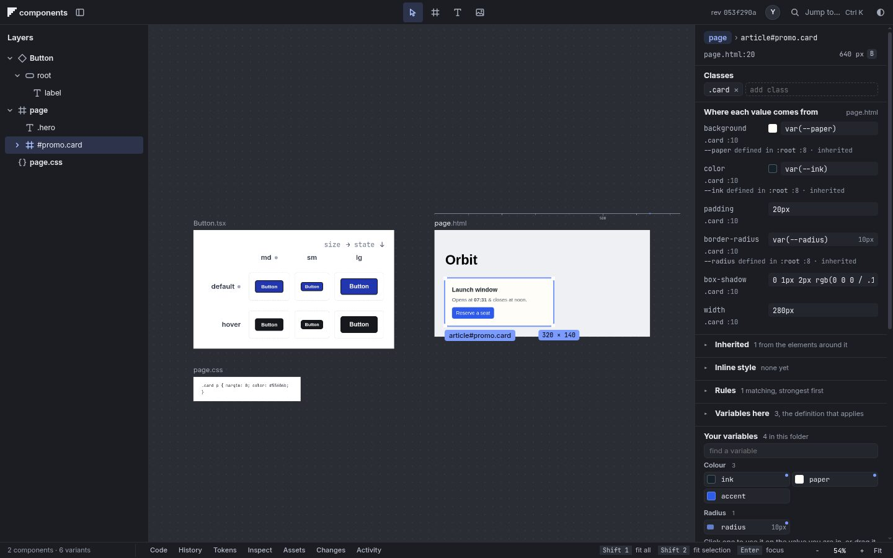
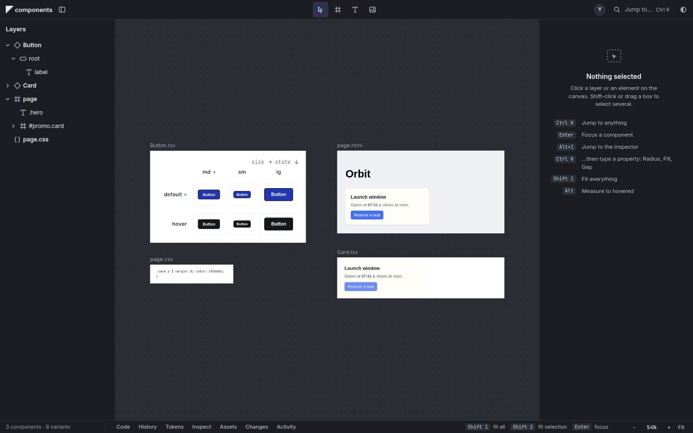

# Basics pass 3: a component from a selection

Standards section 9. Select an element in an HTML frame, run **Create component** (Ctrl+Alt+K, or the palette), and it
becomes a component of its own that looks the same. Nothing is asked first.

## What happens
- A `.tsx` file is written beside the frame, named from the selection's class, id or tag (`.card` gives `Card.tsx`; a
  taken name gets the next free one, and an existing file is never overwritten).
- The markup becomes plain JSX that reads as if written by hand. The CSS rules that reach the selection travel with it,
  inside their media queries, with the keyframes they name, the type and colour inherited from the page, and the custom
  properties they read.
- Selectors that name ancestors outside the selection (`.shell > .offer`) are rewritten against the component and written
  as `:where(...)` in their cascade order, so the same declarations win. What the elements around it gave it (inherited
  type and colour, custom properties followed through each other, media queries included) sits on a `display: contents`
  wrapper, so a button or a `pre` keeps its native type. `url(...)` from a stylesheet in another folder is rebased, and a
  component's view resolves relative URLs from its own folder. Spaces at the edges of inline elements are kept.
- Scripts and inline handlers stay behind; the message says which.
- The frame's file is not touched. One undo removes the new file.
- The new card is revealed and selected, so the panel shows it. Focus stays where it was.
- When it cannot apply (nothing selected, the whole frame, several elements, something that is already a component) it
  says why in one sentence and makes nothing.

## Where it lives
- `src/doc/to-component.js`: HTML and CSS to a component source; `src/doc/component-css.js`: the CSS that keeps it looking the same.
- `src/doc/folder.js` `componentFrom`, `POST /api/frames/component { from, node, name? }`.
- `public/canvas/make-component.js`; the command is `make-component` in the action registry, so menus can list it.
- Tests: `test/basics/to-component.test.js`, `test/basics/component.test.js`, `test/basics/component-fidelity.test.js` (measured in the browser).

## Not yet
- The selection is not replaced by an instance of the new component; the frame stays as it was.
- No props are inferred; text and attributes are literal.
