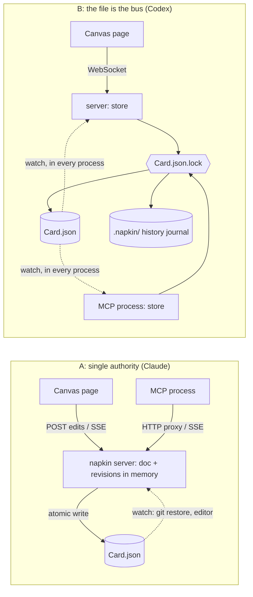

# 0002: Live sync and edit path for the spike (single authoritative server)

Status: **accepted for the spike** (revisit at Phase 4)
Date: 2026-10-18 · Chosen by: AI build lead (Claude), from two built variants. David has not reviewed this yet.

## Context
FEATURES.md "Build first" items 2-4 (F02, F03, F06, F07) need one edit path for the canvas and the agent, per-property revision checks, and changes pushed both ways in under a second. The real choice is **who owns the document while a session runs**. Two variants were built against the same contract (`test/CONTRACT.md`) and the same tests:

- **A** (built by Claude, branch `explore/sync-a`): one server process owns the Card. It keeps integer revisions and a per-key history in memory and serialises `apply()` with a promise queue. The MCP process is a thin HTTP proxy. Every revision is pushed over Server-Sent Events. External writes are picked up by a directory watcher as `by: "file"`.
- **B** (built by Codex, branch `explore/sync-b`): there's no authority. Each process commits straight to the file under an `O_EXCL` lock file. Revisions are a sha256 of the bytes. A shared append-only journal in `.napkin/` stores keys and a doc snapshot per revision. Each process watches the directory. The canvas uses a hand-rolled RFC 6455 WebSocket.

## Results (same machine, CPU only, Node 26, zero npm dependencies in both)

| Measure | A: single authority | B: file is the bus |
|---|---|---|
| Acceptance tests 1-5 (`npm test`, 12 checks) | 12/12 | 12/12 (run by the build lead; Codex's sandbox blocked `git` and `listen`) |
| Full suite repeated 10× | 10/10 | 10/10 |
| Agent → canvas, p50 / p95 (`bench/sync-bench.js`, 50 rounds) | 0.7 / 1.2 ms | 11.2 / 12.1 ms |
| Canvas → agent notice, p50 / p95 | 1.1 / 1.5 ms | 11.7 / 12.8 ms |
| Concurrent canvas + agent edits, both landed | 50/50 | 50/50 |
| Cost of one edit after 2,000 edits (store only) | 0.03 ms (flat) | 12.1 ms (grows linearly: rereads the whole journal) |
| Extra files written next to the component | none | `.napkin/` journal (1.7 MB after 2,000 edits) + transient `.lock` |
| Code (variant modules + page) | 320 lines, 16.8 KB | 268 lines, 16.2 KB |
| Clarity | Plain and spread out; one place to reason about order | Dense; the correctness of lock + reconcile + replay has to be checked carefully |

## Decision
Take **A** for the spike and merge it into `feat/core`. Both pass everything. A wins on latency (about 10× lower), constant cost per edit, and keeping the repo clean (no sidecar files next to "files you own"), and it's easier to reason about. Its main constraint, that agents edit through a running `napkin open` session, matches the workflow guide, which already lists a running session as a prerequisite.

## Consequences
- An agent can't edit through MCP unless the canvas server is running. If that turns out to matter, a fallback is an MCP that opens its own store when no server answers.
- Revisions are integers that restart with the server. A client holding an old revision after a restart gets `stale revision` and rereads, which is safe. **Worth borrowing from B for Phase 4:** content-hash revisions survive restarts and identify external edits for free.
- Two servers on one file, or a tool writing the file directly while edits are in flight, fall back to "the file change becomes a new revision". There's no lock across processes. B's lock + journal is the reference if multi-process writers become a requirement.
- `explore/sync-b` is kept, unmerged, as the reference for that design.
