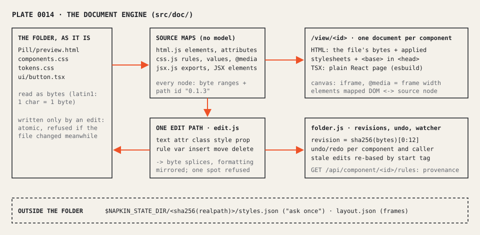

# 0014: The document engine: a source map per file, one splice path, one iframe per component

Status: **proposed** · Date: 2026-10-30 · Written by the AI builder for P1 (Claude, Opus). The architecture below is the AI's choice; David has not decided on it. It implements decision 0013 (accepted, David).

## Context
Decision 0013 makes the file text the source of truth: napkin opens any folder, renders each component as a browser renders that file, and edits by small text changes in place, for HTML/CSS first and TSX/JSX too. The engine the canvas had (decision 0002/0003: a model of a narrow TSX dialect, rewritten through recast, sidecars, a token file named in `napkin.json`) can neither open `secret-sauce/ds/project` (0 components) nor edit most real TSX. The P0 measures (bench/fidelity.js, edits.js, imposed.js) and the engine contract in `.dream-gauntlet/plan.md` fix what the new engine must do from the outside.

## Decision

1. **No model: a source map.** Each file is read as bytes (latin1, so one character is one byte and offsets are byte offsets; UTF-8 passes through untouched) and mapped, not converted:
   - `src/doc/html.js`: a tokenizer that follows the browser's rules where they decide where an element starts and ends (raw-text elements, void and foreign self-closing elements, implied end tags for `p`, `li`, `dt/dd`, table parts and `option`). Every element with a start tag in the source is a node with its byte ranges (start tag, each attribute with its quote style, content, end tag). Elements the browser adds by itself (an implied `<tbody>`) have no node. Node ids are paths among source children (`0.1.3`).
   - `src/doc/css.js`: rules, declarations (value span without spaces, comments or `!important`), `@import`, `@media` and other contexts, each by byte range. Nothing is normalised.
   - `src/doc/jsx.js`: Babel's AST (already a dependency) for any `.tsx`/`.jsx`, run on the latin1 text so its offsets are bytes. Exported components are found by shape (a capitalised function, class, or `forwardRef`/`memo` call); JSX elements get the same node shape as HTML elements.
2. **One edit path.** `src/doc/edit.js` turns every contract op (text, attr, prop, class, style, rule, var, insert, move, delete) into byte splices in one file, for HTML, CSS and TSX alike. It mirrors the file's own formatting in anything new (quote style, `a:b` vs `a: b`, one declaration per line, the indentation and line endings around it). A spot that cannot be written as text (a `className={cn(...)}`, a computed `style`) is refused alone, with the reason; the file stays editable. An ambiguous `rule`/`var` target is refused with the list of matches unless `media`/`index` choose one (contract ruling 7); when exactly one candidate already declares the property, that one is meant.
3. **Revisions, undo and stale edits.** A revision is a hash of the file's bytes. `src/doc/folder.js` keeps undo and redo per component and caller (each step holds every file it changed, so a `rule` edit to a shared stylesheet made through a component is undone through that component), the last 20 texts of each file, and re-bases an edit made against an older revision when its nodes still start with the same start tag at one place. Undo of a file someone changed since is re-based the same way, or refused; napkin never overwrites another change. Writes are atomic (`src/atomic.js`) and refused if the file changed while napkin was writing. A per-directory watcher reports outside changes.
4. **A real document per component.** `GET /view/<id>` serves an HTML file's own bytes with two additions at the top of `<head>`: the folder's applied stylesheets and a `<base>` for its relative URLs. TSX renders on a plain React page, bundled by esbuild with the folder's own `node_modules`. The canvas shows each HTML component as a same-origin iframe of this URL, so `@media` answers to the frame's width and the page is exactly what the browser draws. This replaces decision 0012's light-DOM cell reset for HTML components; dialect TSX cells keep it until they move to iframes too.
5. **Nothing imposed.** `node src/cli.js open <folder>` needs nothing in the folder and writes nothing there except the edits someone makes (sidecars only with `--write-sidecars`). The "ask once" answer (which stylesheets apply when files use variables nothing defines) is kept in napkin's state dir, under a hash of the folder's real path (`NAPKIN_STATE_DIR`, else `$XDG_STATE_HOME/napkin`, else `~/.local/state/napkin`). `GET /api/styles` lists the undefined variables (those used without a fallback) and suggests the folder's stylesheets that define them.
6. **The dialect engine stays beside it.** The TSX-dialect workspace (`src/workspace.js`, `src/store.js`) still serves the canvas's dialect features (variant matrices, props, instances, proposals) for dialect files. The server answers the engine contract for every file of the folder from the new engine, and routes `/api/undo` by component id.

## Consequences
- D1 measures 100% of the P0 corpus within 0.1% of the browser's own render; D2's 60 edits are exact to the byte; D4 leaves `git status` clean.
- Provenance (moment 2) and rule highlighting (moment 3) read `GET /api/component/<id>/rules`: every rule of a component's cascade with its file, line and byte range, in cascade order. The canvas matches rules to elements in the iframe itself (`element.matches`, `matchMedia`), so the answer is the browser's.
- Two edit paths exist for dialect TSX until the canvas's dialect features move onto the splice path: the contract's ops go through `src/doc/edit.js`, the canvas's dialect ops through `src/store.js`. Both write whole files atomically and both are watched, so they see each other's changes.
- An HTML file is one component (contract ruling 4). Variants inside a file (modifier classes, repeated examples) are a canvas concern for later lanes.
- Implied elements have no node, so they cannot be selected; a `<tbody>` the browser adds is reached through its source parent and children.
