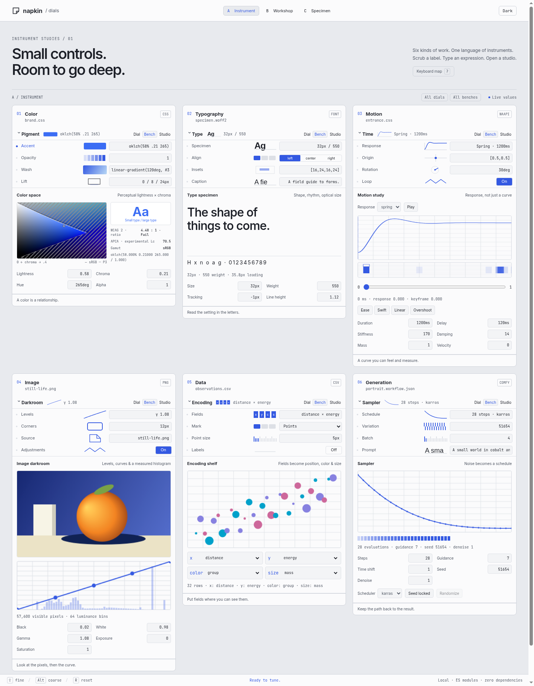
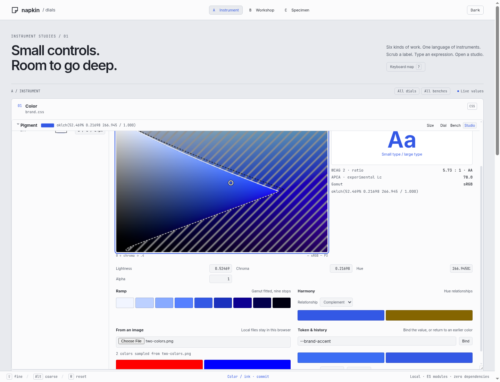
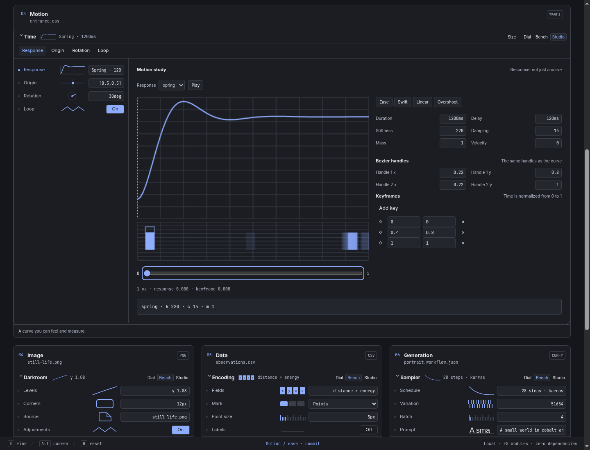
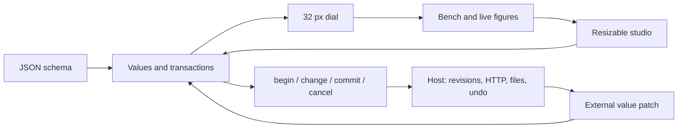

# Dials: instruments with room to grow

`public/dials/` is a standalone browser library with no runtime dependencies. It does not import napkin server code, canvas code or a framework. Serve the directory, import `dials.js`, and load `dials.css`. It follows napkin's `--nk-*` chrome tokens when present and supplies light/dark fallbacks when used alone.

## Run and inspect

From the repository root:

```sh
node test/dials/serve.js
```

Open the printed URL. The server binds a random free localhost port. Stop that process with Ctrl C when finished. It never uses the owner's live port. The six sample documents are color, typography, motion, image adjustment, chart encoding and generation. Expand the catalogue for thirteen further controls and a custom plugin example. Each schema is inspectable in the page and exported from `public/dials/schemas.js`.

- `demo.html?dir=a`: cool, compact instrument chrome; 32 px rows, sans labels and mono values.
- `demo.html?dir=b`: ruled workshop plates; square fields, annotation gutter, 36 px bench rows and hatched miniatures.
- `demo.html?dir=c`: a specimen desk; two broad columns, open 48 px bench rows and larger figures.

All directions keep collapsed sections at 32 px. The round-one directions use identical documents and behavior. Theme switching is on the top bar. Section buttons are keyboard accessible; `1`, `2`, `3` on those buttons select a depth. A focused label accepts arrows, counts, reset and `S` to open its own studio. Enter or Space on a live figure opens its studio. The studio's instrument buttons switch between every control in the section. Focus Size and use arrows to resize the pane, or drag its resize corner.







The [evidence folder](../public/dials/evidence/) also contains directions B/C, dark variants, the collapsed dial state, narrow-screen studio, and recorded timing samples. These are browser captures of the shipped demo, not design mockups.

## Library entry point

```js
import { Dials } from './public/dials/dials.js';

const panel = new Dials(document.querySelector('#inspector'), {
  direction: 'a',
  theme: 'light',
  history: false, // Host owns durable undo.
  onDepth(section, depth) {
    document.querySelector('#inspector').classList.toggle('wide', depth === 3);
  }
});
panel.render(await fetch('/api/controls/item-id').then(r => r.json()));
```

The convenience form is `render(schema, container, options) → panel`. `render` replaces the selected document. Use `update({ controlId: value }, { revision })` for external value patches; it preserves the existing rows, focused entry and active gesture. `get(id)` and `values()` return clones. `open(controlId, 3)` opens one control's studio. `setDepth(sectionId, 1|2|3)` changes the section without replacing its rows. `destroy()` cancels local edits, releases studio animation/subscriptions/object URLs and removes the panel.

See [the complete schema](dials-schema.md) and the browser [TypeScript declaration](../public/dials/dials.d.ts).



## Edit lifecycle and host persistence

`value` events carry `{control,value,previous,phase,source,transaction,baseRevision}`. `begin` occurs once for a gesture. `change` occurs for each valid intermediate value. `commit` closes the gesture; `cancel` restores its starting value. A focus-and-blur with no edit may commit an unchanged value, so hosts should compare `previous` and `value` before writing. A plugin uses the same lifecycle through its context.

```js
panel.addEventListener('value', async ({ detail: e }) => {
  if (e.phase === 'change') preview(e.control, e.value);
  if (e.phase !== 'commit' || JSON.stringify(e.previous) === JSON.stringify(e.value)) return;
  const response = await fetch('/api/control', {
    method: 'POST',
    headers: { 'Content-Type': 'application/json' },
    body: JSON.stringify({
      item: selectedItem, control: e.control, value: e.value,
      baseRevision: e.baseRevision
    })
  }).then(r => r.json());
  // Fetch the host's authoritative value/revision after an accepted or rejected write.
  reconcileFromHost(response);
});
panel.addEventListener('command', ({ detail }) => {
  if (detail.command === 'undo') undoItemThroughHost();
});
panel.addEventListener('conflict', ({ detail }) => showConcurrentEdit(detail));
```

The host must serialize writes and own real undo grouping. This sketch does not implement a write queue or pretend that independent async handlers are ordered. `history:false` delegates label-level undo/redo commands to the host. Default local history is capped at 200 in-memory edits. Native text-entry undo stays native.

When an external value arrives during a local edit, the library queues it for that control and leaves the gesture alone. The local final event carries its original revision. A differing queued value produces `conflict`; then the remote value is applied and that control's local undo history is cleared. This is observable behavior rather than an implicit last-writer merge. The HTTP adapter decides whether to reject, rebase or retry the local operation.

## Custom controls and figures

```js
import { registerControl, registerFigure } from './public/dials/dials.js';

const unregister = registerControl('gain', {
  mount(ctx) {
    const input = document.createElement('input');
    input.type = 'range'; input.min = '0'; input.max = '1'; input.step = '.01';
    input.setAttribute('aria-label', ctx.control.label);
    input.addEventListener('input', () => {
      ctx.begin('gain-slider'); ctx.change(Number(input.value));
    });
    input.addEventListener('change', () => ctx.commit());
    return { element: input, update: value => { input.value = value; } };
  }
});
registerFigure('gain', (host, control, value) => {
  // Update existing nodes if they can receive focus.
  host.textContent = `${Math.round(value * 100)}%`;
});
```

Plugins may provide `studio(context, host)` as well. Controls and figures register separately, so a file adapter can request a familiar control with a domain-specific figure. Unregistering affects future mounts; rerender to replace an existing mounted view. Custom types are application code, never code embedded in JSON.

## Validation and evidence

Run one suite at a time:

```sh
node --test test/dials/math.test.js
node --test test/dials/browser.test.js
# Refresh screenshots and measured samples:
DIALS_EVIDENCE=public/dials/evidence node --test test/dials/browser.test.js
```

The Node suite checks arithmetic and rejection paths, reference OKLab coordinates, RGB round trips, gamut boundaries, black/white WCAG and APCA values, spring damping regimes, bezier endpoints and sampler schedules. The Chromium suite uses the repository's `src/chromium.js` lifecycle through its CDP helper, software rendering with GPU disabled, random-port static server, real key/pointer events, and cleanup in `finally`.

The browser suite checks all demo directions and themes, 32 px dials, node identity across depth changes, expression entry and invalid drafts, local undo/redo, numeric counts, modifier scrubbing, queued updates/conflicts, all basic control edit paths, CSS color syntax, plugins, focus indication, reduced motion, narrow layout, and axe. Performance evidence contains 15 swaps of a 200-control document, 100 update/layout samples and 50 real pointer moves per number, color, motion and image control traced from a capture-phase mark to the end of Chromium's next software `Paint`. That last measurement includes the rendering path; it does not measure physical display scanout. Hardware and browser differences still matter.

## Integration boundary and remaining gaps

This lane owns neither `/api/controls` nor `/api/control`, file adapters, source bytes, canvas selection or durable undo. The other lanes must expose the schema, route committed values through revision checks, persist edits or recipes, and restore file bytes exactly on undo. No canvas or server files were changed here.

The library has a real editing surface for the listed types, with these limits:

- CSS parsing depends on browser support. Color output offers four formats; the original input string is preserved until an edit. Wide-gamut boundaries are numerical, but the raster plane is sRGB. The APCA readout is experimental and not a compliance certification.
- Typography axes are declared by the host; font-table discovery is not implemented. The demo uses the existing repository variable font for its weight axis, with a system-font fallback.
- Image adjustment is a local preview with five linear curve knots, rectangle crop and a circular mask. It does not implement arbitrary masks, native-resolution image export or image metadata persistence. Palette extraction is frequency bucketing.
- The motion track stores normalized scalar keyframes and previews them. It does not parse or rewrite CSS/WAAPI itself, or provide multi-property tracks. Those mappings belong to adapters.
- The sampler studio illustrates schedules and settings. It does not submit generation jobs, assume installed models or claim to reproduce every scheduler's backend math.
- The gradient composer has two stops; arbitrary CSS remains editable in the row. File pick emits a File and its name; persistence is explicit host work.
- The keyboard map comes from the same key definitions as the command dispatcher. Label commands can be rebound with `options.keys` (`increase`, `decrease`, `reset`, `studio`, `help` arrays of key names); the help map uses those actual bindings. A global canvas command palette remains integration work.
