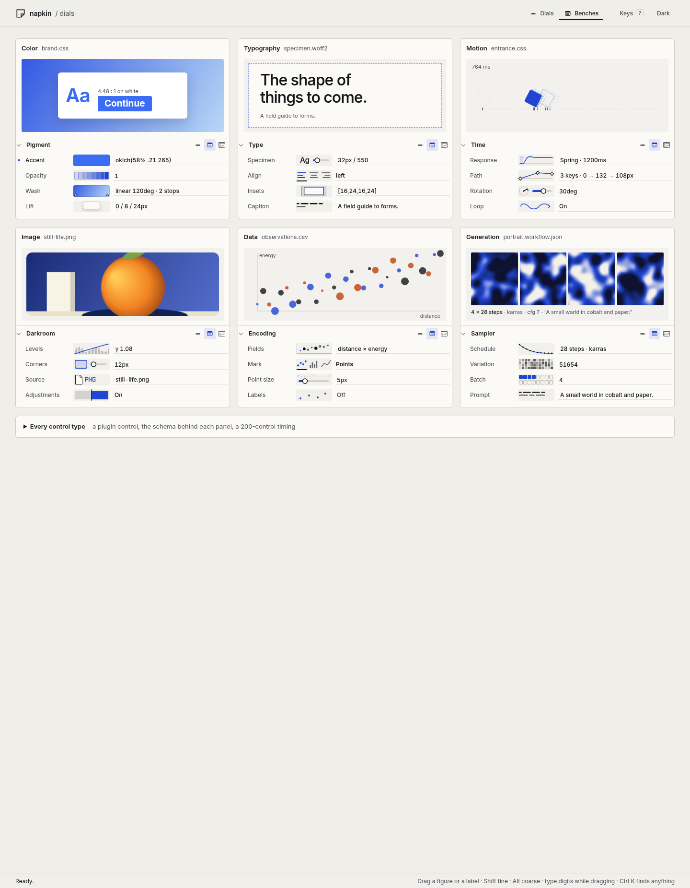
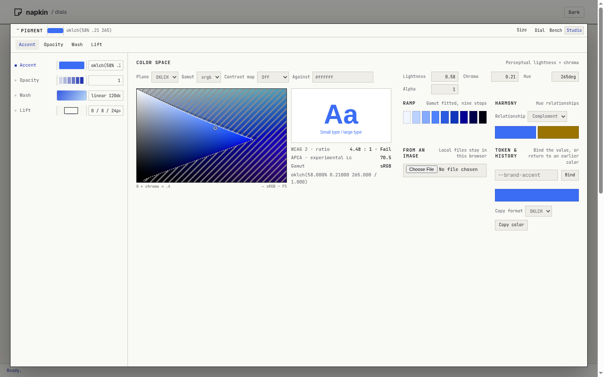
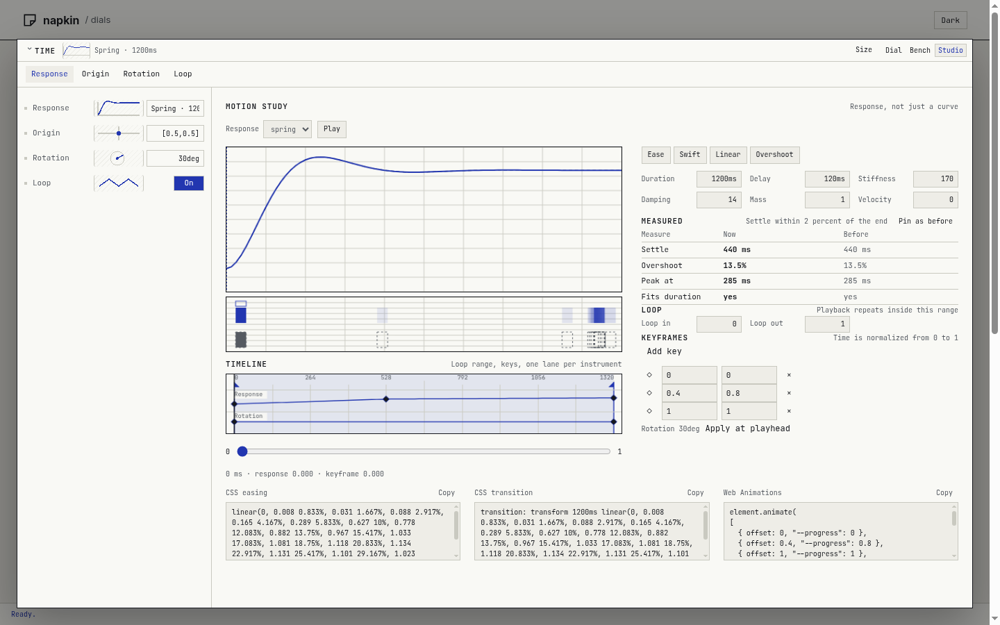
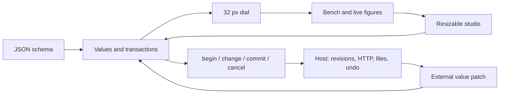

# Dials: instruments with room to grow

`public/dials/` is a standalone browser library with no runtime dependencies. It does not import napkin server code, canvas code or a framework. Serve the directory, import `dials.js`, and load `dials.css`. It follows napkin's `--nk-*` chrome tokens when present and supplies light/dark fallbacks when used alone.

## Run and inspect

From the repository root:

```sh
node test/dials/serve.js
```

Open the printed URL. The server binds a random free localhost port. Stop that process with Ctrl C when finished. It never uses the owner's live port. The six sample documents are color, typography, motion, image adjustment, chart encoding and generation. Expand the catalogue for thirteen further controls and a custom plugin example. Each schema is inspectable in the page and exported from `public/dials/schemas.js`.

The demo uses one visual language, the quiet pro tool: ink and paper with one hard accent (cobalt), Inter for words, and the Stem 7 pixel face for one hero readout per studio and a few live numerals. Every row carries a drawn figure at row height that is itself the control (drag it, or the label), an underlined value field beside it, one figure size and one track length. Each sample card shows the thing its values make (a button on a wash, a specimen, a moving block, the image, the chart, the seed tiles) above its panel. Fonts ship in `public/dials/fonts/` (Inter under the OFL, Stem 7 is the owner's own face).

Theme switching is on the top bar. Section buttons are keyboard accessible; `1`, `2`, `3` on those buttons select a depth. A focused label accepts arrows, counts (`3` then `l` moves three steps), reset and `S` to open its own studio. Enter or Space on a live figure opens its studio. While a label, a figure or a studio handle is held, typed digits replace the value and Enter applies them; a focused studio handle takes typed numbers the same way, shown in a small tag above it.

`g` is a leader key. `g` then `h j k l` (or arrows) moves focus to the nearest instrument in that direction by its position on screen, across labels, figures, values and studio handles. `g g` and `g e` go to the first and last row of the section, `g s` opens the studio, `g 1/2/3` sets the depth, `g r` resets, `g u` undoes and `g /` opens the palette. If `g` is rebound to another action, that action wins.

`Ctrl K` opens the palette: an opaque `role=dialog` with a combobox and `role=option` entries. Each entry carries the control's own figure, and a preview pane shows the figure, the full value and the description of the selected entry (a reset entry previews the default). Enter goes to the control and Shift Enter opens its studio. `?` opens the key map, the same kind of dialog, which lists these keys and lets you rebind them.

No value is clipped. Row values wrap onto as many lines as they need (text values are a one-row `textarea` that grows with `field-sizing: content`), labels wrap, and long values in studios are shown in full.

A studio takes the window when the panel is created with `studio: "viewport"` (the demo does). It is a fixed pane with a backdrop; content is laid out in columns so nothing hides below a scroll. Without that option the studio stays inside the host. Escape or the Dial and Bench buttons close it. Focus Size and use arrows to resize the pane.







The [evidence folder](../public/dials/evidence/) also contains every studio in both themes, the collapsed dial state, the narrow-screen studio, and recorded timing samples. These are browser captures of the shipped demo, not design mockups.

## Motion studio

The studio opens for a `motion` or `keyframes` control and works on the whole section: the response, the keyframes, a rotation (`angle`) and a loop (`boolean` whose id or label says loop).

- **Response.** A curve over milliseconds, delay included. In bezier mode the two handles sit on the curve and drag; in spring mode the first peak drags (across sets when it arrives, which sets stiffness; up and down sets overshoot, which sets damping). The delay and the end are handles too. Hover or focus a handle and its numbers show in a chip beside it. The settle point is a dashed line; a spring that is cut off by its duration is shaded.
- **Path.** Keyframes are diamonds on a timed track: offset across, translateX up, with millisecond ticks and pixel gutter labels. Drag a diamond, use arrows on a focused one, Delete removes a middle key, double-click the track adds one. Each segment eases with the response, as CSS animations and per-frame WAAPI easing do.
- **Spacing.** Where the element is every 50 ms, with the before and after positions outlined and the live block moving through them. Pause stops it; reduced motion shows the end state.
- **Presets** are drawn curves, ringed when active. Fields for the shape and the timing sit beside them; the numbers table is in the rail.
- **Loop range.** Two flags under the response curve set a part of the motion to loop. The preview plays only that part, the curve and the path track shade it, and the button beside the response says which milliseconds loop (click it to play the whole again). On a `motion` value it is stored as `loopRange: [from, to]` (fractions of one iteration); a bare `bezier` or `spring` control keeps it in the studio only.
- **Lanes.** Under the path track, one lane per animated value in the keyframes: opacity always, rotate and scale when a frame's `transform` has them, and any other number a frame carries. Each lane has its own diamonds that drag up and down (arrows too), eased per segment like the track. The preview block turns with the rotate lane.
- **Code.** Three tabs: a `transition` rule, an `@keyframes` animation, and a WAAPI `animate()` call. Springs are written as `linear()` plus a `--dials-spring: k d m v` custom property (a comment in WAAPI) so they read back exactly; a bare `linear()` is fitted back to a spring. The code is editable: what you type is parsed and applied to the panel. Reading is tolerant: single, double or backtick quotes, bare keys, trailing commas, comments, `Infinity`, and a bare duration number as the second `animate()` argument. When the code cannot be read, a note under the box says so in plain words with the line and column (for example `Line 3, column 14: "wobble" is not a value (put text in quotes).`), the panel keeps the last motion that read cleanly, and the typed text stays in the box until it is fixed.

For a host that writes files: every `commit` value event on a motion or keyframes control carries `detail.code = { transition, keyframes, waapi }`. `panel.motionCode(sectionId)` returns the same object at any time, and `panel.applyMotionCode(sectionId, text)` reads CSS or WAAPI text back into the section (one undoable edit per changed control). The pure functions `motionCode` and `readMotionCode` are exported from `motion.js`.

## Talking to napkin's HTTP contract

`public/dials/remote.js` connects a panel to `GET /api/controls/<item>`, `POST /api/control` and `POST /api/undo`:

```js
import { Dials } from './public/dials/dials.js';
import { connect } from './public/dials/remote.js';
const panel = new Dials(mount, { studio: 'viewport' });
const link = connect(panel, { item: 'brand.css' });
await link.load({ render: true });
// every commit is one POST with baseRevision; a refused write reloads the real values
// await link.undo();  // asks the server to restore the earlier bytes
```

`test/dials/remote.test.js` drives this against a stand-in server that checks `baseRevision` and restores bytes on undo. It is not napkin's real server: pointing the same code at the server lane's implementation is the integration step.

## Library entry point

```js
import { Dials } from './public/dials/dials.js';

const panel = new Dials(document.querySelector('#inspector'), {
  studio: 'viewport',
  theme: 'light',
  history: false, // Host owns durable undo.
  onDepth(section, depth) {
    document.querySelector('#inspector').classList.toggle('wide', depth === 3);
  }
});
panel.render(await fetch('/api/controls/item-id').then(r => r.json()));
```

The convenience form is `render(schema, container, options) → panel`. `render` replaces the selected document. Use `update({ controlId: value }, { revision })` for external value patches; it preserves the existing rows, focused entry and active gesture. `get(id)` and `values()` return clones. `open(controlId, 3)` opens one control's studio. `setDepth(sectionId, 1|2|3)` changes the section without replacing its rows. `destroy()` cancels local edits, releases studio animation/subscriptions/object URLs and removes the panel.

See [the complete schema](dials-schema.md) and the browser [TypeScript declaration](../public/dials/dials.d.ts).



## Edit lifecycle and host persistence

`value` events carry `{control,value,previous,phase,source,transaction,baseRevision}`. `begin` occurs once for a gesture. `change` occurs for each valid intermediate value. `commit` closes the gesture; `cancel` restores its starting value. A focus-and-blur with no edit may commit an unchanged value, so hosts should compare `previous` and `value` before writing. A plugin uses the same lifecycle through its context.

```js
panel.addEventListener('value', async ({ detail: e }) => {
  if (e.phase === 'change') preview(e.control, e.value);
  if (e.phase !== 'commit' || JSON.stringify(e.previous) === JSON.stringify(e.value)) return;
  const response = await fetch('/api/control', {
    method: 'POST',
    headers: { 'Content-Type': 'application/json' },
    body: JSON.stringify({
      item: selectedItem, control: e.control, value: e.value,
      baseRevision: e.baseRevision
    })
  }).then(r => r.json());
  // Fetch the host's authoritative value/revision after an accepted or rejected write.
  reconcileFromHost(response);
});
panel.addEventListener('command', ({ detail }) => {
  if (detail.command === 'undo') undoItemThroughHost();
});
panel.addEventListener('conflict', ({ detail }) => showConcurrentEdit(detail));
```

The host must serialize writes and own real undo grouping. This sketch does not implement a write queue or pretend that independent async handlers are ordered. `history:false` delegates label-level undo/redo commands to the host. Default local history is capped at 200 in-memory edits. Native text-entry undo stays native.

When an external value arrives during a local edit, the library queues it for that control and leaves the gesture alone. The local final event carries its original revision. A differing queued value produces `conflict`; then the remote value is applied and that control's local undo history is cleared. This is observable behavior rather than an implicit last-writer merge. The HTTP adapter decides whether to reject, rebase or retry the local operation.

## Custom controls and figures

```js
import { registerControl, registerFigure } from './public/dials/dials.js';

const unregister = registerControl('gain', {
  mount(ctx) {
    const input = document.createElement('input');
    input.type = 'range'; input.min = '0'; input.max = '1'; input.step = '.01';
    input.setAttribute('aria-label', ctx.control.label);
    input.addEventListener('input', () => {
      ctx.begin('gain-slider'); ctx.change(Number(input.value));
    });
    input.addEventListener('change', () => ctx.commit());
    return { element: input, update: value => { input.value = value; } };
  }
});
registerFigure('gain', (host, control, value) => {
  // Update existing nodes if they can receive focus.
  host.textContent = `${Math.round(value * 100)}%`;
});
```

Plugins may provide `studio(context, host)` as well. Controls and figures register separately, so a file adapter can request a familiar control with a domain-specific figure. Unregistering affects future mounts; rerender to replace an existing mounted view. Custom types are application code, never code embedded in JSON.

## Validation and evidence

Run one suite at a time:

```sh
node --test test/dials/math.test.js
node --test test/dials/browser.test.js
# Refresh screenshots and measured samples:
DIALS_EVIDENCE=public/dials/evidence node --test test/dials/browser.test.js
```

The Node suite checks arithmetic and rejection paths, reference OKLab coordinates, RGB round trips, gamut boundaries, black/white WCAG and APCA values, spring damping regimes, bezier endpoints and sampler schedules. The Chromium suite uses the repository's `src/chromium.js` lifecycle through its CDP helper, software rendering with GPU disabled, random-port static server, real key/pointer events, and cleanup in `finally`.

The browser suite checks both themes, 32 px dials, node identity across depth changes, expression entry and invalid drafts, local undo/redo, numeric counts, modifier scrubbing, queued updates/conflicts, all basic control edit paths, CSS color syntax, plugins, focus indication, reduced motion, narrow layout, and axe. Performance evidence contains 15 swaps of a 200-control document, 100 update/layout samples and 50 real pointer moves per number, color, motion and image control traced from a capture-phase mark to the end of Chromium's next software `Paint`. That last measurement includes the rendering path; it does not measure physical display scanout. Hardware and browser differences still matter.

Last recorded on this machine (round 6, software-rendered headless Chromium, `public/dials/evidence/*timings.json`): 200-control swap p95 23 ms (target < 50), the same swap on screen to the first frame p95 32.8 ms, a mixed 200-control document p95 28.4 ms; update work per scrub step p95 0.4 ms; pointer move to painted frame p95 3.8 ms (number), 3.8 ms (color), 6.2 ms (motion), 7.2 ms (image), target < 16.7 ms.

## Studios

Every studio has the same parts: a rail under the rows (the secondary numbers and key hints), a main column of drawings you drag, and a side column with the hero readout in Stem 7, choices and fields. A studio field is a name you can scrub, a typed value (expressions allowed) and a 4 px bar with a 14 px thumb that is a keyboard slider; painted bars show what they change (lightness, chroma, hue, alpha, exposure). No browser select or range input is used.

- **Colour:** the OKLCH or OKLab plane with gamut lines, painted L, C, H and A bars under it, the contrast ratio as the hero with the proof card, background choice, code formats, ramp and harmony. Token binding, sampling from an image (a drop well) and history sit in the rail.
- **Type:** the specimen edited in place over its leading lines, a size ladder, an axis lab where one handle sets weight across and size up over the faces it would make, weight steps drawn as glyphs, and the character set in the rail.
- **Motion:** see above.
- **Image:** the picture with eight crop handles, the mask ring and a before/after split you drag; the tone curve drawn over the source histogram with five points on the curve and black, grey and white level triangles under it; gamma as the hero with clipping and kept size; aspect choices, a source drop well, and looks in the rail.
- **Data:** the chart linked to its rows (hover one, the other lights), channels picked on a row of names or by dropping a field, every field with its distribution in the rail (focus one and press x, y, c or s), and the correlation of x and y as the hero.
- **Sampler:** the noise schedule with the other schedulers dashed behind it and handles for steps, denoise and time shift, a per-step ladder of how much noise each step removes, seed tiles for the batch, and model evaluations as the hero.

Studios are drawn when opened, so swapping a whole panel stays cheap.

### Every other control: the instrument frame

Each tab of a studio is one control. Controls the six labs above own (colour, typography, motion and its relatives, image, encoding, sampler) open those labs. Every other control, including types the library has never seen, opens the instrument frame in `instruments.js`, so a studio is finished for every control of every section by construction:

- **Stage** (main column): a drawing of the value you drag. Numbers by figure or unit: an opacity checkerboard, a corner radius on a still life, a tile count, a true-size px square, a time bar for ms and s, a pie for %, a lamp for kelvin, else a ruler. Angles get a dial with a needle (Shift snaps to 15°), booleans the Off and On states drawn as a pair, choices option cards (keys 1 to 9 pick), text a ruled editor (weighted prompt words for prompt-like text, a four-size specimen otherwise), vectors a pad, gradients a band with stop handles, shadows a card with an offset dot and blur ring, spacing a box model, seeds twelve neighbouring tiles, assets a preview, number lists draggable bars, and objects one lane per key (bars, switches, nested bars) plus a tolerant JSON source box with a line-numbered error.
- **Strip** under the stage: minis across the range you can click or arrow through.
- **Side:** the readout (the full value, wrapped, never cut), fields, the value against the default with a Reset, a "Declared as" list of the schema keys and why this instrument was chosen, and this session's committed values (click one to go back).

The kind is chosen from the type, then the figure, then the shape of the value. `registerInstrument(type, make)` (exported from `dials.js`) replaces the stage for a type; `make(api)` returns `{ node, draw(value), strip?, hero?, fields? }`. The demo's `lampRig` schema (exported from `schemas.js`, on `window.dialsDemo`) is a panel the library was not written for: a vector aim, an angle tilt, a shadow, spacing, a seed, a kelvin range, a segmented mode with object options, an unknown `dmx-universe` object and a long text cue. `test/dials/shots.mjs` renders it in a 560 px host.

`node test/dials/shots.mjs <outdir> [filter]` screenshots every sample at every depth, every studio tab of every section, the palette (empty, typed and reset), the key map and every lamp rig tab in the narrow host, in light and dark at 1x and 2x (`SCALES`, `THEMES` narrow it).

## Integration boundary and remaining gaps

This lane owns neither `/api/controls` nor `/api/control`, file adapters, source bytes, canvas selection or durable undo. The other lanes must expose the schema, route committed values through revision checks, persist edits or recipes, and restore file bytes exactly on undo. No canvas or server files were changed here.

The library has a real editing surface for the listed types, with these limits:

- CSS parsing depends on browser support. Color output offers four formats; the original input string is preserved until an edit. Wide-gamut boundaries are numerical, but the raster plane is sRGB. The APCA readout is experimental and not a compliance certification.
- Typography axes are declared by the host; font-table discovery is not implemented. The demo uses the existing repository variable font for its weight axis, with a system-font fallback.
- Image adjustment is a local preview with five linear curve knots, rectangle crop and a circular mask. It does not implement arbitrary masks, native-resolution image export or image metadata persistence. Palette extraction is frequency bucketing.
- Motion code covers translateX keyframes with lanes for opacity, rotate, scale and other numbers in the frames, a rotation, a loop and a loop range. Colours and other non-numeric properties in an `@keyframes` block are kept in the frame records but get no lane. Writing the file is the host's job, using `detail.code`.
- The sampler studio illustrates schedules and settings. It does not submit generation jobs, assume installed models or claim to reproduce every scheduler's backend math.
- The gradient instrument edits linear gradients (stops and angle); other gradient kinds remain editable as CSS in the row. File pick emits a File and its name; persistence is explicit host work.
- The keyboard map comes from the same key definitions as the command dispatcher. Label commands can be rebound with `options.keys` (`increase`, `decrease`, `reset`, `studio`, `help` arrays of key names); the help map uses those actual bindings. A global canvas command palette remains integration work.
