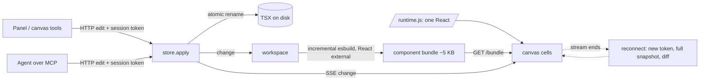

# Engine: what the numbers measure and what produced them

AI built the harness and the fixes; David has not yet reviewed them. Numbers and re-run commands are in `docs/evidence/` (one `.txt` and `.json` per row). Method details are in `bench/README.md`; the decision is `docs/decisions/0011-engine-shared-runtime-and-bounded-history.md`.

## Where a panel edit's time goes (PRF-02, 200 components)
Tab key, then POST and SSE (about 30 ms, mostly waiting behind a frame), bundle fetch and mount (about 15 ms), the frame that paints it. The frame itself was the largest cost: with a transform on each of 200 frames, and 17,000 hidden but still styled elements, each frame spent about 25 ms in layerize. Moving frames with `left`/`top`, and removing the contents of culled frames, took the median edit from 227 ms to 74 ms.

## Results (re-run commands are in each file)

| Row | Bar | Measured | Evidence |
|---|---|---|---|
| PRF-01 cold open, 40 components | p50 <= 1.5 s | p50 1043 ms, p95 1060 ms | PRF-01.txt |
| PRF-02 panel edit to pixels, 200 components | p95 < 100 ms | p50 73.6, p95 74.6 ms | PRF-02.txt |
| PRF-03 agent edit (MCP) to pixels | p95 < 100 ms | p50 63.7, p95 92.9 ms | PRF-03.txt |
| PRF-04 5 s pan | p95 frame <= 16.7 ms | p95 16.7 to 16.8 ms (timer ticks 0.1 ms; 0 to 4 of about 300 frames over 20 ms); with zoom steps p95 16.8 | PRF-04.txt |
| PRF-05 rebuild | p95 <= 50 ms | p95 7.9 ms | PRF-05.txt |
| PRF-06 edit #2000 vs #1 | <= 2x | 0.49x (9.2 vs 18.6 ms) | PRF-06.txt |
| PRF-07 memory at 200 | server <= 500 MB, page <= 400 MB | 129 MB, 18 MB | PRF-07.txt |
| PRF-08 typing | p95 <= 50 ms | p50 38.0, p95 38.8 ms (47.9 in another run) | PRF-08.txt |
| REL-03 reconnect | <= 2 s | worst 204 ms; stale, never lost | REL-03.txt |
| REL-04 30-minute soak | 0 errors, RSS growth <= 20% | 0 errors, 12.4% (first run 35.5%) | REL-04.txt, REL-04-before.txt |
| REL-05 branch switch, 40 components | <= 2 s | 667 ms | REL-05.txt |

The numbers move a little from run to run (a shared machine, CPU-only Chromium); the .json files keep every sample. PRF-04 is measured with `requestAnimationFrame` intervals, which the browser reports in 0.1 ms steps, so a steady 60 Hz reads 16.6 to 16.8 and the 16.7 bar sits inside that noise. A zoom step re-rasterises the viewport on the CPU and costs two to four vsyncs while no main-thread task runs over 20 ms.
