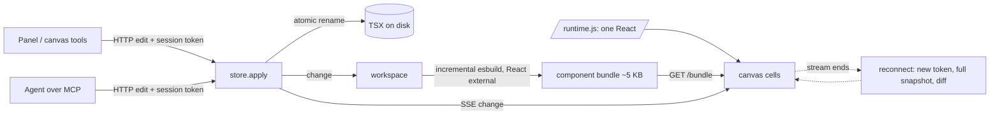

# Engine: what the numbers measure and what produced them

AI built the harness and the fixes; David has not yet reviewed them. Numbers and re-run commands are in `docs/evidence/` (one `.txt` and `.json` per row). Method details are in `bench/README.md`; the decision is `docs/decisions/0010-engine-shared-runtime-and-bounded-history.md`.

## Where a panel edit's time goes (PRF-02, 200 components)
Tab key, then POST and SSE (about 30 ms, mostly waiting behind a frame), bundle fetch and mount (about 15 ms), the frame that paints it. The frame itself was the largest cost: with a transform on each of 200 frames, and 17,000 hidden but still styled elements, each frame spent about 25 ms in layerize. Moving frames with `left`/`top`, and removing the contents of culled frames, took the median edit from 227 ms to 74 ms.
