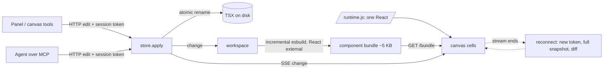

# Engine: what the numbers measure and what produced them

AI built the harness and the fixes; David has not yet reviewed them. Numbers and re-run commands are in `docs/evidence/` (one `.txt` and `.json` per row). Method details are in `bench/README.md`; the decision is `docs/decisions/0011-engine-shared-runtime-and-bounded-history.md`.

## Where a panel edit's time goes (PRF-02, 200 components)
Tab key, then POST and SSE (about 30 ms, mostly waiting behind a frame), bundle fetch and mount (about 15 ms), the frame that paints it. The frame itself was the largest cost: with a transform on each of 200 frames, and 17,000 hidden but still styled elements, each frame spent about 25 ms in layerize. Moving frames with `left`/`top`, and removing the contents of culled frames, took the median edit from 227 ms to 74 ms.

## Results (re-run commands are in each file)

| Row | Bar | Measured | Evidence |
|---|---|---|---|
| PRF-01 cold open, 40 components | p50 <= 1.5 s | p50 1043 ms, p95 1060 ms | PRF-01.txt |
| PRF-02 panel edit to pixels, 200 components | p95 < 100 ms | p50 73.6, p95 74.6 ms | PRF-02.txt |
| PRF-03 agent edit (MCP) to pixels | p95 < 100 ms | p50 63.7, p95 92.9 ms | PRF-03.txt |
| PRF-04 5 s pan | p95 frame <= 16.7 ms | On the grid corpus (200 components, 3 to 10 on screen at 30%): pan raw p95 17.3 to 18.5 ms against a trivial-page floor of 16.9 to 17.1 ms; with zoom steps about 21 ms, one 200 to 380 ms raster stall per run; 10% overview 5 to 10% of frames >= 25 ms. FAILS (see below) | PRF-04.txt |
| PRF-05 rebuild | p95 <= 50 ms | p95 7.9 ms | PRF-05.txt |
| PRF-06 edit #2000 vs #1 | <= 2x | 0.49x (9.2 vs 18.6 ms) | PRF-06.txt |
| PRF-07 memory at 200 | server <= 500 MB, page <= 400 MB | 129 MB, 18 MB | PRF-07.txt |
| PRF-08 typing | p95 <= 50 ms | p50 38.0, p95 38.8 ms (47.9 in another run) | PRF-08.txt |
| REL-03 reconnect | <= 2 s | worst 204 ms; stale, never lost | REL-03.txt |
| REL-04 30-minute soak | 0 errors, RSS growth <= 20% | 0 errors, 12.4% (first run 35.5%) | REL-04.txt, REL-04-before.txt |
| REL-05 branch switch, 40 components | <= 2 s | 667 ms | REL-05.txt |

The numbers move a little from run to run (a shared machine, CPU-only Chromium); the .json files keep every sample. PRF-04 is measured from a Chromium trace (see bench/README.md). During a wheel or drag gesture the view moves only by compositor transform: overlays are placed from geometry cached in canvas units, handles are translated or hidden, culling only adds frames, the title and label scales wait for the view to settle (160 ms idle), and `will-change` is dropped on settle so text is re-rasterised crisp. Frame titles use `zoom` instead of `transform: scale()` (200 scaled titles were 200 paint layers, costing 7 to 9 ms of layerisation per pan event), and attributes are never rewritten with the value they already have (that repaints the page). What the pan path now avoids, found by tracing a grid corpus: a pan frame used to re-layerize the whole page (chunks of every drawn frame, the 200-row layers list, the inspector), 8 to 14 ms. Causes removed: `background-position` on the stage (now a `#grid` layer moved by transform), titles scaled by `transform` (200 paint layers; now `zoom`), attributes rewritten with the same value (a repaint), 50 to 70 drawn frames (now culled outside 0.12 viewport, with `visibility: hidden` for culled frames), and the chrome panels in the same stacking context (`isolation: isolate`). Known weak spots: the chip and axis-label scale (`--nk-ls`) is stale until the view has been idle 160 ms; a zoom step costs a late frame (20 to 25 ms) and a zoom that turns round can stall the compositor for 200 to 380 ms while tiles rasterise on the CPU; at a 10% overview with 120 drawn frames layerising still costs 5 to 8 ms per frame; the settle after a gesture is one 20 to 40 ms task. Titles are kept readable mid-gesture by setting `--nk-lf` on the few titles on screen.
