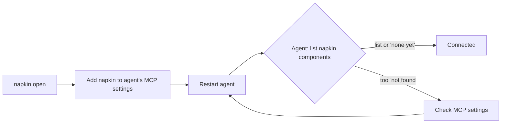

# How to connect your agent to napkin

Serves: **Work on it together**.

## Who it's for and when to use it
For anyone who wants an AI agent to read and edit components on the canvas. Do this once per project, before you [edit together](edit-together.md).

## Prerequisites
- napkin installed and `napkin init` run in your project (see the [quickstart](quickstart.md)).
- An agent that speaks MCP (a standard plug for agent tools), or any program that can make HTTP requests to the API.

## Flow



## Steps
1. Start a session in the project folder:
   ```console
   $ napkin open
   ```
   It prints the canvas address and `agent: MCP over stdio (napkin mcp)`.
2. Add napkin to your agent's MCP settings. For Claude Code, put this in `.mcp.json` at the project root:
   ```json
   { "mcpServers": { "napkin": { "command": "napkin", "args": ["mcp"] } } }
   ```
   Other MCP agents take the same command and arguments in their own settings file.
3. Restart the agent so it loads the new server.
4. Ask the agent: "list napkin components".
5. Optional, for scripts: call the API directly.
   ```console
   $ curl -s localhost:4810/api/components
   [{"id":"cmp_7f3a","name":"Button","file":"components/Button.html","versions":6}]
   ```

### What the agent can do
The MCP server offers these tools (working names):

| Tool | What it does |
|---|---|
| `list_components` | Names, IDs and files of every component in the project |
| `read_component` | The current component, its versions, settings and the revision number |
| `list_tokens` | The colours, spacing and radius tokens from your token file |
| `create_component` | Make a new component file from a structure the agent supplies |
| `apply_edits` | Apply a batch of edits (set, insert, delete, move). `dry_run: true` shows the result without saving |

Every edit, from you or the agent, goes through the same path as `apply_edits`. A batch that fails a check changes nothing.

## What you see when it worked
- The agent replies with a component list, or "no components yet".
- The canvas status bar shows "agent connected".

## Common problems and fixes
| Problem | Fix |
|---|---|
| Agent says it has no napkin tool | It didn't load the settings. Check the file name and location, then restart the agent. |
| `napkin mcp: no session in this folder` | Run `napkin open` in the same project folder first. |
| Canvas never shows "agent connected" | The agent started `napkin mcp` from a different folder. Set the agent's working directory to the project root. |
| `curl` connection refused | The session isn't running, or it uses another port. `napkin open` prints the port. |

## Limits
- Local only: the agent and napkin run on the same machine.
- One project per session.
- Who may connect, and with which permissions, isn't designed yet. Any agent that can start `napkin mcp` in your folder can edit. ([GAPS.md](GAPS.md), G6.)
