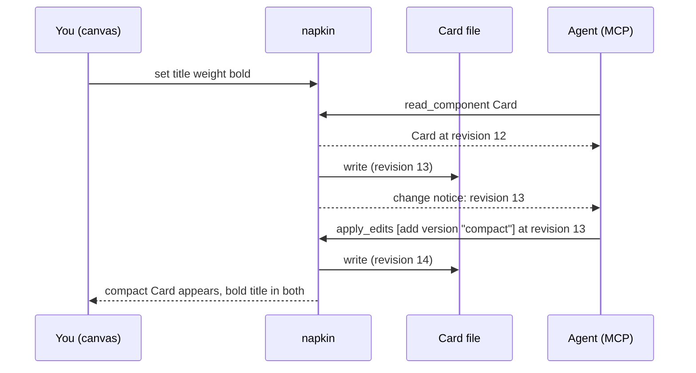

# How to edit a component together with your agent

Serves: **Work on it together**. This is napkin's proving demo.

## Who it's for and when to use it
For anyone who wants an AI agent's UI changes to land on the same component they are working on, without copying changes by hand from a chat window. Use it when you want the agent to do a chunk of work (a new state, a compact version) while you keep adjusting details.

## Prerequisites
- A running session (`napkin open`).
- Your agent [connected](connect-your-agent.md).
- A component to work on. [Start one](start-a-component.md) if you have none.

## Flow



## Steps
1. Click the Card on the canvas to open it.
2. Type your request to the agent, naming the component:
   > On the napkin Card, add a compact version with a smaller image and tighter padding.
3. Keep working while it runs. For example, select the title and set **Weight** one step bolder.
4. Watch the presence label. It reads "agent: editing Card / compact" while the agent works.
5. When the label clears, check the result:
   - The compact Card sits next to the original.
   - Your bolder title is in both, because you changed the base.
6. Ask the agent for the next change, or keep editing by hand. Each side sees the other's edits as they land.

### What the agent receives
When you edit, the agent gets a change notice with the new revision and the edit, for example:
```json
{ "component": "Card", "revision": 13, "by": "you", "edits": [{ "op": "set", "path": "title.fontWeight", "value": 600 }] }
```

## What you see when it worked
- Your edit and the agent's edit are both on the canvas, with no reload.
- The component file holds both changes:
  ```console
  $ git diff --stat
   components/Card.html | 14 ++++++++++++--
  ```
- The agent's reply refers to the current Card, including your change.

## Common problems and fixes
| Problem | Fix |
|---|---|
| The agent's edit was rejected: `stale revision` | It edited an old copy. It should call `read_component` again and retry. Agents usually do this on their own. |
| The agent changed a different component | Name the component in the request, or select it on the canvas and say "the selected component". |
| You and the agent changed the same property at the same moment | What happens is not decided yet ([GAPS.md](GAPS.md), G2). Until it is, avoid editing the property you asked the agent to change. |
| Your edit vanished after the agent's | Report it. Edits to different properties must both survive. |
| Nothing updates on the canvas | The file watcher stopped. Check the terminal running `napkin open` for errors and restart it. |

## Limits
- One person and one or more agents on one machine. Several people on several machines is not covered.
- Same-property clashes are undecided (G2).
- In-app undo per edit, and a record of who made each edit, aren't promised yet ([GAPS.md](GAPS.md), G5). Use git to review and undo ([keep-your-files.md](keep-your-files.md)).
