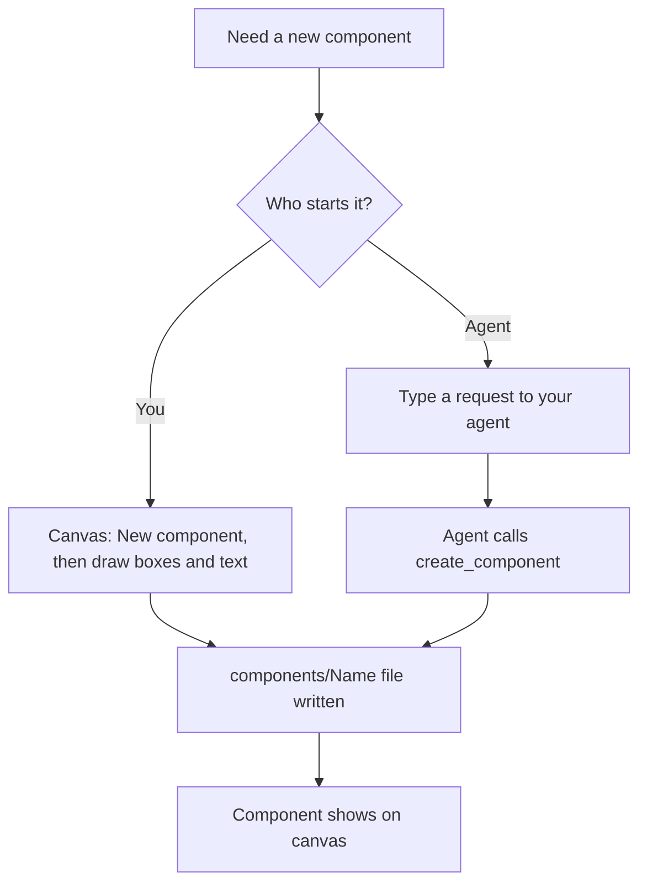

# How to start a component

Serves: **Work on it together**, **Change every version at once**, **Keep plain files you own**.

## Who it's for and when to use it
For anyone beginning a new Button, Card, form field or other component. Use it when the component doesn't exist yet. You can draw it yourself or ask your agent to rough it out in your colours and spacing.

## Prerequisites
- A running session (`napkin open`).
- For the agent route: your agent is [connected](connect-your-agent.md).
- Optional: a token file set in `napkin.json`, so new components use your colours and spacing.

## Flow



## Steps

### Route A: draw it
1. On the canvas, press **N** or click **New component**.
2. Type a name, for example `Card`, and press Enter. napkin writes `components/Card.html` (illustrative name, see [GAPS.md](GAPS.md), G1).
3. Draw a box with **R**, add text with **T**, and drop an image slot with **I**.
4. In the right panel, pick values from your tokens: **Padding** `space-4`, **Radius** `radius-hardware`, **Fill** `sheet`.
5. To add a setting (prop), select the title text and click **Make setting**. Name it `title`.

### Route B: ask your agent
1. Type a request with a name, its parts and the tokens to use:
   > Make a napkin Card with an image, a title and a short body. Use our tokens: sheet fill, space-4 padding, radius-hardware corners. Make the title a setting.
2. The agent calls `list_tokens`, then `create_component`.
3. The Card appears on the canvas, with a presence label "agent: created Card".

## What you see when it worked
- The component is on the canvas and in the left list.
- The file exists:
  ```console
  $ ls components/
  Card.html
  ```
- In the right panel, values show as token names (`space-4`), not raw numbers.

## Common problems and fixes
| Problem | Fix |
|---|---|
| "Card already exists" | Each name is one file. Pick another name, or open the existing Card. |
| Values show as raw pixels, not tokens | The token file isn't set or didn't load. Run `napkin tokens` to see what napkin read. |
| The agent made a static picture with no settings | Ask it to name the settings ("make the title a setting"). |
| The agent picked colours outside your tokens | Ask it to use only `list_tokens` values. napkin marks off-token values with an orange dot. |

## Limits
- napkin starts new components. Opening components that already live in your repo, written by hand, isn't designed yet ([GAPS.md](GAPS.md), G4).
- The file format and framework are not decided ([GAPS.md](GAPS.md), G1).
- Tokens are read from your token file. Editing the tokens themselves is out of scope for this guide.
