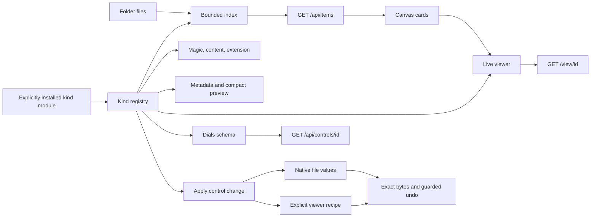
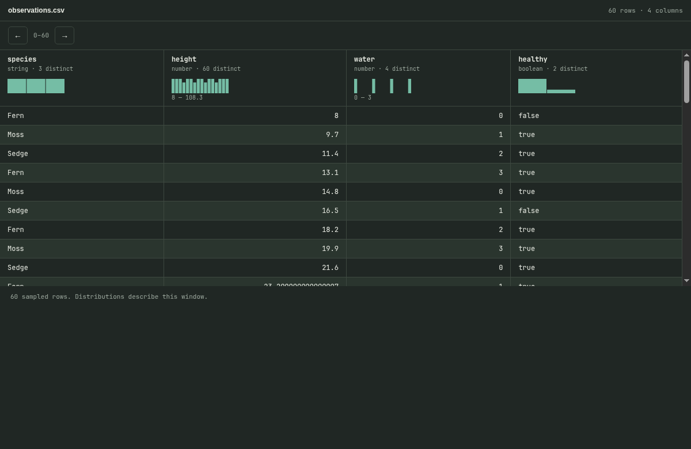
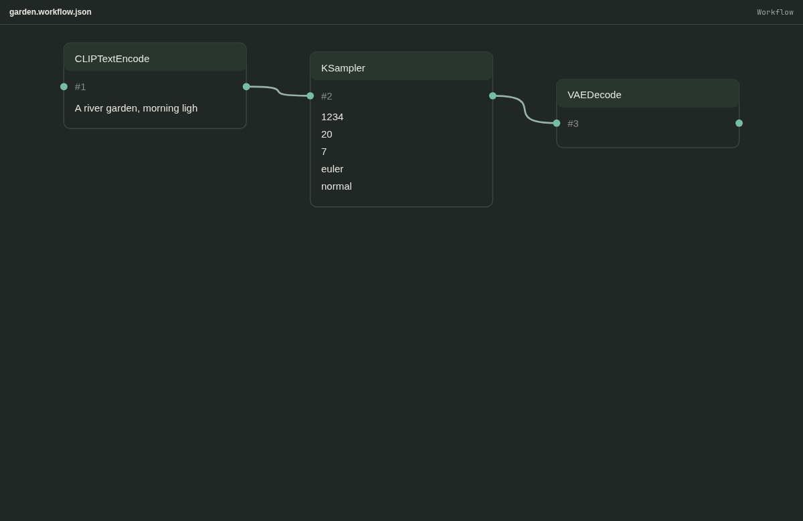
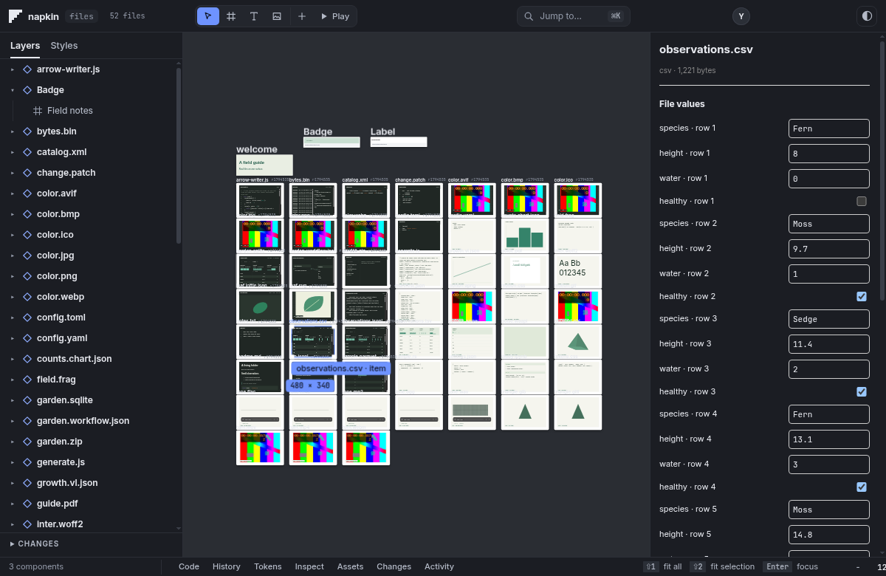

# Files on the canvas

Open a folder normally. Every visible file is an item, including files that export no
component. The existing skip list still excludes dotfiles and generated dependency and
build directories. Symlinks may point within the opened folder, never outside it.

```sh
node src/server.js --dir test/kinds/samples --port 0
```

The server prints its chosen localhost URL. `test/kinds/samples/generate.js` rebuilds
the samples using Node and local ffmpeg. It generates the media, geometry, notebook,
workflow, ZIP, SQLite, Arrow and Parquet files. The font is Inter from the existing
public font collection; its OFL license is included.

## One definition per kind



`src/kinds/registry.js` is the authority. Each entry owns `detect`, `metadata`, `viewer`,
`controls`, and `apply`, with an optional `preview` data reader. Rendering and format
readers are reusable helpers rather than a second extension dispatch table in the server.
Magic and content matches outrank extension matches. Later registrations win ties.

There are 59 built-in definitions:

| Surface | Kinds |
| --- | --- |
| Components and styles | html, tsx, jsx, css, css-keyframes, css-animation (an html page with `@keyframes`), waapi (an html page that calls `.animate()`) |
| Images | svg, png, jpg (also jpeg), gif, apng, webp, avif, bmp, ico |
| Video | mp4, webm, mov |
| Audio | wav, mp3, flac, ogg (also opus), m4a |
| Structured data | csv, tsv, json, jsonl, parquet, sqlite, arrow |
| Charts and animation | vega-lite, chart (plain `{type, x, y, data}` or `series`), lottie, waapi-json |
| Reading and source | md, txt, code, diff, patch, ipynb, pdf (drawn page by page with poppler), yaml, toml, xml, shader |
| Models | obj, gltf, glb |
| Type | ttf, otf, woff, woff2 |
| Work and containers | comfyui, agent-run, zip, binary |

Image and media codecs use the browser's native decoder. A recognized container whose
codec the browser cannot decode still has its identity and instruments; recognition
alone is not a claim that every codec inside that container plays.

At an overview scale, cards show small source-derived previews: sampled typed rows and
distributions, archive paths, graph connections, notebook cells, mesh geometry, log
events and binary strings. At reading scale or on selection, the same `/view` page used
standalone becomes the live card. The stage keeps a budget of 40 live documents.
Compact cards keep their geometry and content while the live viewers are unloaded.

HTML, TSX and JSX files are items in the API but are drawn once, as components, by the
TSX dialect or the document engine, so nothing about them changes. A component's own
`.napkin.json` sidecar is part of that component and gets no card. File cards are packed
after the components, never among them, so a component does not land somewhere else
because other files exist. When components are present, the first view frames them;
Shift+1 frames everything. Components take the live-frame budget first and file cards
give their frame back when a component needs it.

## HTTP surface

Use percent-encoded item IDs in URLs. IDs are relative paths, and remain stable while
file contents change. A TSX file has one item; its existing exported component IDs
(such as `Button.tsx#Button`) also continue to work in `/view`.

| Route | Result |
| --- | --- |
| `GET /api/items` | `{ items: [{ id, path, kind, mime, bytes, meta }] }` |
| `GET /view/<id>` | Standalone live viewer; document root has `data-napkin-kind` |
| `GET /api/controls/<id>` | `{ revision, sections: [{ id, label, controls }] }` |
| `POST /api/control` | `{ item, control, value, baseRevision }` → `{ ok, revision }` |
| `POST /api/undo` | `{ item }` → `{ ok, revision }` |
| `GET /file/<id>` | Streaming file bytes, HEAD and single byte ranges |
| `GET /api/item-data/<id>` | A bounded viewer window; optional `offset`, `group`, `table`, `entry` |
| `GET /api/kinds` | Registered kind names, families, MIME information and extensions |
| `GET /api/item-layout` | Item frame positions, stored outside the opened folder |
| `POST /api/item-layout` | `{ item, x, y }` saves a frame position |

Writes use the same bearer sessions and agent permissions as the existing API. Obtain a
token with `POST /api/session { "as": "you" }`. A stale revision returns 409. Unsupported
controls and invalid values make no change. File events are delivered through the
existing `/api/events` stream as `item-change` and `items-changed`.

Each control has `id`, `type`, `label`, `value`, `depth`, and a small `figure` descriptor.
Bounds, units, options and `storage: "recipe"` are additive fields. Native source spans
are private to the server, not editable offsets accepted from the caller. The fallback
canvas panel consumes this schema; the dials library can consume the same routes.

## Where edits go

JSON leaves replace their literal span, preserving surrounding formatting. SVG
attributes, CSS variables, CSV/TSV cells and markdown front matter likewise edit their
source location. Source controls cover text and component files. CSV values are typed;
quoting and line endings outside the edited cell are preserved.

Viewer settings that the file cannot represent are saved as
`<filename>.napkin-recipe.json`. Examples include image exposure, video poster time,
audio gain, font specimen text, model rotation, table windows and binary offsets.
Component viewer zoom also uses a recipe. A read never creates one. Recipes themselves
are ordinary JSON items.

Decision [0018](decisions/0018-kinds-registry-and-recipes.md) records this choice.
Undo restores the exact previous bytes and removes a newly created recipe. It refuses
to overwrite a later external edit. Item undo histories currently live in memory and
are bounded per item; they do not survive restart. The canvas has an item Undo button
and routes Ctrl/Cmd Z to the selected item's history.

## Add a kind without changing core

A plugin is a trusted ES module installed explicitly by the person starting the server.
Nothing in an opened folder is discovered or executed as a plugin.

```js
// field-note.mjs
export default function install({ registerKind }) {
  registerKind({
    id: 'field-note',
    family: 'note',
    mime: 'text/plain',
    extensions: ['.fieldnote'],
    detect: c => c.ext === '.fieldnote',
    metadata: c => ({ excerpt: c.text.slice(0, 160) }),
    viewer: c => {
      const text = c.text.replaceAll('&', '&amp;').replaceAll('<', '&lt;');
      return `<html data-napkin-kind="field-note"><body><article>${text}</article></body></html>`;
    },
    controls: c => [{
      id: 'note', label: 'Note', controls: [{
        id: 'text', type: 'textarea', label: 'Text', value: c.text, depth: 2,
        figure: { type: 'value' }
      }]
    }],
    apply: (c, control, value) => ({ source: value })
  });
}
```

```sh
NAPKIN_KIND_PLUGINS=./field-note.mjs node src/server.js --dir ./work --port 0
```

Separate multiple modules with commas. A detection function may return a numeric
priority (built-in extension matches use 1, content/magic matches 2). Boolean true uses
2. IDs must be unique lowercase names. `mime` may be a string or a function of context.
A context contains `id`, `path`, `file`, `kind`, `bytes`, `head`, `text`, `recipe`, and
`revision` for view/edit operations. Detection and metadata get a 64 KiB head; views and
controls get at most 1 MiB. `apply` returns `{ source }` or `{ recipe }`. The common
transaction layer handles validation, revisions, atomic writes and undo. Plugin viewers
must escape file content and put their kind on the root element.

## Read limits and format coverage

Indexing reads a 64 KiB head plus bounded metadata for formats with footer directories.
It caches detection and metadata by file identity, size and modification time. Media
streams use ranges; they never pass through the whole-file document cache.

| Reader | Current boundary |
| --- | --- |
| CSV/TSV/JSONL | Every row reachable (one-pass index, UTF-8 and UTF-16 with or without a byte order mark); 120 displayed rows; distributions describe the window on screen |
| JSON and notebooks | 1 MiB document preview; larger files show the limit |
| Parquet | hyparquet (vendored): every row reachable by offset, nested and logical types, all page encodings, Snappy, gzip, Brotli and zstd; reads only the row groups that hold the window |
| Arrow | IPC files with flat primitive numeric, text, binary, boolean and date/time vectors; reads selected vector windows |
| SQLite | Read-only connection, selected table and bounded row query |
| ZIP | Central directory up to 8 MiB; entry preview up to 1 MiB; stored and deflated entries; no ZIP64 or encrypted entries |
| Audio | PCM WAV peaks from a bounded prefix; local ffmpeg optionally decodes up to 60 seconds for other codecs |
| 3D | three.js (vendored) for glTF, GLB and OBJ: PBR materials, textures, skins, morph targets, animation clips, scene cameras, Meshopt. Draco-compressed meshes are named as not decoded |
| Lottie | lottie-web (vendored): precompositions, masks, mattes, gradients, trim paths, repeaters, text, expressions, image assets; 3D layers are drawn flat and said so |
| Charts | Inline numeric data and bar, line, area-line and point marks; no full Vega expression engine or external data loader |
| PDF | Browser's native PDF viewer |
| Source edits | Up to 1 MiB; larger edits need a streaming format adapter |

Formats with a real runtime (Parquet, Lottie, glTF, OBJ) are drawn by that runtime, not by a
miniature of it: see docs/decisions/0021-kinds-real-format-runtimes.md. Anything a runtime cannot
do is named on the view. Nested or dictionary Arrow and compressed IPC still need an adapter.

## Evidence

Run one test suite at a time:

```sh
node --test test/kinds/contract.test.js
node --test test/kinds/plugin.test.js
node --test test/kinds/browser.test.js
node --test test/kinds/performance.test.js
```

The contract tests check all generated samples, source edits, exact undo, conflict and
permission refusals, real data and waveform values, a 2 GiB MP4 with a valid padding box,
a 5,000,000-row Parquet file, and a 1,000-file mixed index. The plugin test adds a complete
kind without changing core. The browser tests check actual content and save screenshots
under `$KINDS_EVIDENCE` (default: a temporary folder, so test runs leave the tree clean; the figures below are kept in `docs/kinds-figures/`). The performance test reports opening and pan frame timings;
its open-time assertion does not establish the separate frame-time target.







## Round 2 notes

- Text is decoded as UTF-8, UTF-16 (with a byte order mark) or, when UTF-8 fails, Latin-1. A bare MPEG frame sync only counts as mp3 when the file is named .mp3, because it is also the UTF-16 byte order mark.
- A JSON file that is a list of records is shown as a typed table with distributions, above its tree.
- Long tables (a Parquet file with millions of rows, a SQLite table, an Arrow file) scroll like a document: the scrollbar spans every row and the rows drawn follow where it stops. Parquet is read at any row offset, to the last row.
- Fonts show their glyph count, read from their own tables (ttf, otf, woff, woff2 through Brotli).
- Video cards show a poster (`/api/poster/<id>`, one ffmpeg frame, two at a time) and load the clip when the pointer reaches for it.
- A folder of more than 150 files opens on its first files at 30%, grouped by kind, with room for each title. Shift+1 still fits everything. File cards stay out of the picture until they are placed and their picture has arrived; a component that is not drawn live shows the first lines of its file.
- Under 20 screen pixels wide a frame is not loaded live.

## Text encodings, damaged images and zoomed-out cards

- Text kinds are decoded before they are previewed: UTF-8, UTF-16 with or without a byte order mark, and Windows-1252 for older single-byte files. The raw bytes on disk are never changed.
- An image the browser cannot decode (cut short, wrong signature) shows a plain message with its size and first bytes instead of a broken-image icon. Its card carries no invented dimensions.
- When the board is zoomed out, every compact card shows its kind and its main fact (rows, duration, size, entries) in type large enough to read at 30 percent.

## Round 4: viewers run the format

- **Vega-Lite** is interpreted by `public/canvas/vega-lite.js`: inline, named and same-folder data; filter, calculate, aggregate, bin, timeUnit, fold, window and joinaggregate transforms; linear, log, sqrt, time and band scales; stacking; bar, line, area, point, circle, square, tick, rule, text, rect and arc marks; layers, hconcat, vconcat, facet and repeat; legends. Anything it cannot run (other marks, projections, interactive parameters) is named under the chart ("Not drawn: ...") instead of being replaced by something else. The older `{type, x, y, data}` and `{series}` chart shapes are converted to the same specification (`chart-spec.js`). Text categories sort in natural order (orbit-2 before orbit-10), which is a deliberate difference from Vega-Lite's plain alphabetical order.
- **glTF, GLB and OBJ** run on three.js (`public/canvas/model-runtime.js`, loaded only when a 3D file opens; `public/canvas/model-three.js` is the viewer: clock, scrubber, clip and camera menus, orbit by pointer or keys). On a canvas card the light software drawing (`model-view.js`, fed by `src/kinds/gltf.js`) shows first and the real runtime takes over when the card is pointed at, clicked or focused, so a thousand folders stay cheap; it is also the fallback when WebGL is missing or its context is lost. `src/kinds/gltf.js` still produces the card metadata (counts, materials, the first pose).
- **Lottie** runs on lottie-web (`public/canvas/lottie-runtime.js`). Shapes listed straight on a layer are wrapped in a group first, as the player expects.
- **Parquet** runs on hyparquet (`src/vendor/hyparquet`, `src/kinds/parquet.js`). The footer is read synchronously and cached per file revision; rows come through byte ranges of the file.
- **Focus.** Enter on a file card focuses it like a component: the card stays at full strength and clickable (every stage section, files included, takes the focus mark). A page whose name does not say HTML (`renamed.bin`) is still one card, drawn in a sandboxed frame.
- **Delimited and line files** (CSV, TSV, JSONL) are indexed once in a single streaming pass (`src/kinds/rowindex.js`: the byte offset of every 500th record, quoted line breaks tracked across chunks), so any row of a file of any size can be reached with bounded memory. UTF-16 files (either byte order, with or without a byte order mark) are indexed by 16-bit unit, so they reach their last row too.
- **Content sniffing.** When the name says nothing (no extension, `.bin`, `.dat`, `.txt`, `.log`), HTML, JSON, JSONL, CSV and TSV are recognised from their contents. A recipe can also name the kind (`"kind": "csv"` in `<file>.napkin-recipe.json`, or the "Open as" control).
- **Cards show the item's own content at every zoom.** Model cards draw the posed scene with its material colors, chart cards run the same interpreter, PDF cards show the first rendered page, audio cards draw the real waveform (whole file when it decodes in 20 s, else its first minute). Zoomed out, the kind and main fact are a strip along the bottom edge, not a cover over the content. Audio, PDF and chart cards load when they come within 300 px of the screen.
- **Keyboard.** Waveform: arrows seek 5 s (Shift 15 s), Home and End, Space plays. Model: arrows turn, plus and minus zoom, Space turns or plays, W wireframe, Home resets. PDF: Page Up and Page Down. Long tables scroll with the standard keys.
- **Controls change the picture.** PDF zoom sets the render resolution and the page width; the test compares the drawn page before and after.
- **Undo history survives a restart** (`kind-undo.json` beside the layout, steps stored with their bytes, capped at 8 MiB).
- **Test evidence** is written to a temporary folder (or `$KINDS_EVIDENCE`), so test runs leave the tree clean.
