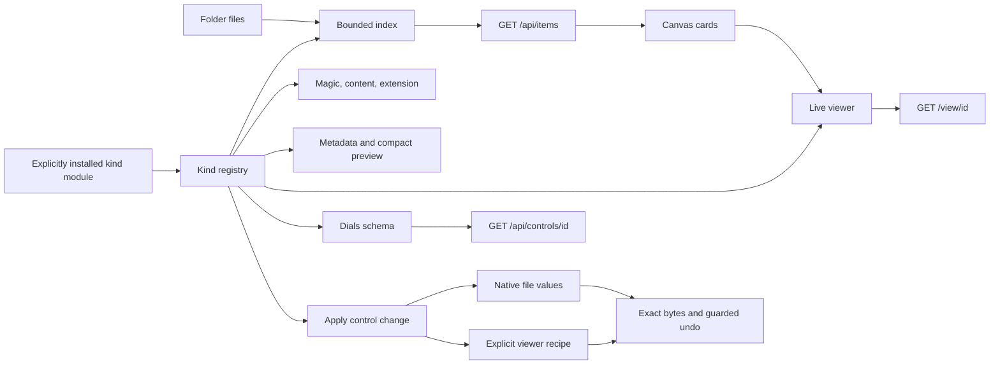
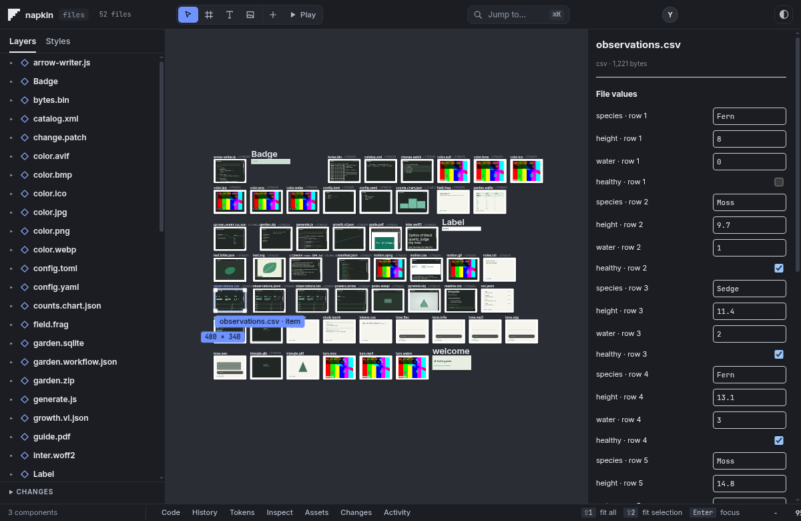

# Files on the canvas

Open a folder normally. Every visible file is an item, including files that export no
component. The existing skip list still excludes dotfiles and generated dependency and
build directories. Symlinks may point within the opened folder, never outside it.

```sh
node src/server.js --dir test/kinds/samples --port 0
```

The server prints its chosen localhost URL. `test/kinds/samples/generate.js` rebuilds
the samples using Node and local ffmpeg. It generates the media, geometry, notebook,
workflow, ZIP, SQLite, Arrow and Parquet files. The font is Inter from the existing
public font collection; its OFL license is included.

## One definition per kind



`src/kinds/registry.js` is the authority. Each entry owns `detect`, `metadata`, `viewer`,
`controls`, and `apply`, with an optional `preview` data reader. Rendering and format
readers are reusable helpers rather than a second extension dispatch table in the server.
Magic and content matches outrank extension matches. Later registrations win ties.

There are 54 built-in definitions:

| Surface | Kinds |
| --- | --- |
| Components and styles | html, tsx, jsx, css, css-animation |
| Images | svg, png, jpg (also jpeg), gif, apng, webp, avif, bmp, ico |
| Video | mp4, webm, mov |
| Audio | wav, mp3, flac, ogg (also opus), m4a |
| Structured data | csv, tsv, json, jsonl, parquet, sqlite, arrow |
| Charts and animation | vega-lite, chart, lottie, waapi |
| Reading and source | md, txt, code, diff, ipynb, pdf, yaml, toml, xml, shader |
| Models | obj, gltf, glb |
| Type | ttf, otf, woff, woff2 |
| Work and containers | comfyui, agent-log, zip, binary |

Image and media codecs use the browser's native decoder. A recognized container whose
codec the browser cannot decode still has its identity and instruments; recognition
alone is not a claim that every codec inside that container plays.

At an overview scale, cards show small source-derived previews: sampled typed rows and
distributions, archive paths, graph connections, notebook cells, mesh geometry, log
events and binary strings. At reading scale or on selection, the same `/view` page used
standalone becomes the live card. The stage keeps a budget of 40 live documents.
Compact cards keep their geometry and content while the live viewers are unloaded.

HTML, TSX and JSX files are items in the API but are drawn once, as components, by the
TSX dialect or the document engine, so nothing about them changes. A component's own
`.napkin.json` sidecar is part of that component and gets no card. File cards are packed
after the components, never among them, so a component does not land somewhere else
because other files exist. When components are present, the first view frames them;
Shift+1 frames everything. Components take the live-frame budget first and file cards
give their frame back when a component needs it.

## HTTP surface

Use percent-encoded item IDs in URLs. IDs are relative paths, and remain stable while
file contents change. A TSX file has one item; its existing exported component IDs
(such as `Button.tsx#Button`) also continue to work in `/view`.

| Route | Result |
| --- | --- |
| `GET /api/items` | `{ items: [{ id, path, kind, mime, bytes, meta }] }` |
| `GET /view/<id>` | Standalone live viewer; document root has `data-napkin-kind` |
| `GET /api/controls/<id>` | `{ revision, sections: [{ id, label, controls }] }` |
| `POST /api/control` | `{ item, control, value, baseRevision }` → `{ ok, revision }` |
| `POST /api/undo` | `{ item }` → `{ ok, revision }` |
| `GET /file/<id>` | Streaming file bytes, HEAD and single byte ranges |
| `GET /api/item-data/<id>` | A bounded viewer window; optional `offset`, `group`, `table`, `entry` |
| `GET /api/kinds` | Registered kind names, families, MIME information and extensions |
| `GET /api/item-layout` | Item frame positions, stored outside the opened folder |
| `POST /api/item-layout` | `{ item, x, y }` saves a frame position |

Writes use the same bearer sessions and agent permissions as the existing API. Obtain a
token with `POST /api/session { "as": "you" }`. A stale revision returns 409. Unsupported
controls and invalid values make no change. File events are delivered through the
existing `/api/events` stream as `item-change` and `items-changed`.

Each control has `id`, `type`, `label`, `value`, `depth`, and a small `figure` descriptor.
Bounds, units, options and `storage: "recipe"` are additive fields. Native source spans
are private to the server, not editable offsets accepted from the caller. The fallback
canvas panel consumes this schema; the dials library can consume the same routes.

## Where edits go

JSON leaves replace their literal span, preserving surrounding formatting. SVG
attributes, CSS variables, CSV/TSV cells and markdown front matter likewise edit their
source location. Source controls cover text and component files. CSV values are typed;
quoting and line endings outside the edited cell are preserved.

Viewer settings that the file cannot represent are saved as
`<filename>.napkin-recipe.json`. Examples include image exposure, video poster time,
audio gain, font specimen text, model rotation, table windows and binary offsets.
Component viewer zoom also uses a recipe. A read never creates one. Recipes themselves
are ordinary JSON items.

Decision [0018](decisions/0018-kinds-registry-and-recipes.md) records this choice.
Undo restores the exact previous bytes and removes a newly created recipe. It refuses
to overwrite a later external edit. Item undo histories currently live in memory and
are bounded per item; they do not survive restart. The canvas has an item Undo button
and routes Ctrl/Cmd Z to the selected item's history.

## Add a kind without changing core

A plugin is a trusted ES module installed explicitly by the person starting the server.
Nothing in an opened folder is discovered or executed as a plugin.

```js
// field-note.mjs
export default function install({ registerKind }) {
  registerKind({
    id: 'field-note',
    family: 'note',
    mime: 'text/plain',
    extensions: ['.fieldnote'],
    detect: c => c.ext === '.fieldnote',
    metadata: c => ({ excerpt: c.text.slice(0, 160) }),
    viewer: c => {
      const text = c.text.replaceAll('&', '&amp;').replaceAll('<', '&lt;');
      return `<html data-napkin-kind="field-note"><body><article>${text}</article></body></html>`;
    },
    controls: c => [{
      id: 'note', label: 'Note', controls: [{
        id: 'text', type: 'textarea', label: 'Text', value: c.text, depth: 2,
        figure: { type: 'value' }
      }]
    }],
    apply: (c, control, value) => ({ source: value })
  });
}
```

```sh
NAPKIN_KIND_PLUGINS=./field-note.mjs node src/server.js --dir ./work --port 0
```

Separate multiple modules with commas. A detection function may return a numeric
priority (built-in extension matches use 1, content/magic matches 2). Boolean true uses
2. IDs must be unique lowercase names. `mime` may be a string or a function of context.
A context contains `id`, `path`, `file`, `kind`, `bytes`, `head`, `text`, `recipe`, and
`revision` for view/edit operations. Detection and metadata get a 64 KiB head; views and
controls get at most 1 MiB. `apply` returns `{ source }` or `{ recipe }`. The common
transaction layer handles validation, revisions, atomic writes and undo. Plugin viewers
must escape file content and put their kind on the root element.

## Read limits and format coverage

Indexing reads a 64 KiB head plus bounded metadata for formats with footer directories.
It caches detection and metadata by file identity, size and modification time. Media
streams use ranges; they never pass through the whole-file document cache.

| Reader | Current boundary |
| --- | --- |
| CSV/TSV/JSONL | An 8 MiB text window; 120 displayed rows; distributions describe that window |
| JSON and notebooks | 1 MiB document preview; larger files show the limit |
| Parquet | Footer up to 8 MiB; selected row group; flat primitive V1/V2 pages, plain and dictionary/RLE values; uncompressed, Snappy, gzip and Brotli |
| Arrow | IPC files with flat primitive numeric, text, binary, boolean and date/time vectors; reads selected vector windows |
| SQLite | Read-only connection, selected table and bounded row query |
| ZIP | Central directory up to 8 MiB; entry preview up to 1 MiB; stored and deflated entries; no ZIP64 or encrypted entries |
| Audio | PCM WAV peaks from a bounded prefix; local ffmpeg optionally decodes up to 60 seconds for other codecs |
| 3D | Bounded geometry preview, up to 50,000 vertices per accessor; triangle primitives; no materials, skinning or skeletal animation |
| Lottie | Vector shape layers, transforms, paths, fills, strokes and animated properties; no image assets, masks or effects |
| Charts | Inline numeric data and bar, line, area-line and point marks; no full Vega expression engine or external data loader |
| PDF | Browser's native PDF viewer |
| Source edits | Up to 1 MiB; larger edits need a streaming format adapter |

Parquet codecs/encodings outside this set show the real schema, row count and row groups,
with the unsupported feature named. Nested/dictionary Arrow, compressed IPC, richer
Lottie compositions, and full glTF scene transforms need adapters. These are explicit
limits, not whole-file fallback reads.

## Evidence

Run one test suite at a time:

```sh
node --test test/kinds/contract.test.js
node --test test/kinds/plugin.test.js
node --test test/kinds/browser.test.js
node --test test/kinds/performance.test.js
```

The contract tests check all generated samples, source edits, exact undo, conflict and
permission refusals, real data and waveform values, a 2 GiB MP4 with a valid padding box,
a 5,000,000-row Parquet file, and a 1,000-file mixed index. The plugin test adds a complete
kind without changing core. The browser tests check actual content and save screenshots
under `test/kinds/evidence/`. The performance test reports opening and pan frame timings;
its open-time assertion does not establish the separate frame-time target.



