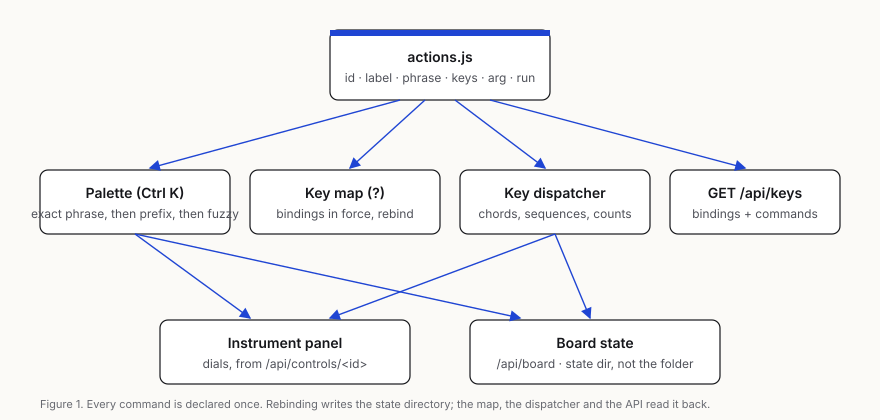

# Surface: one panel, one palette, one key map

The surface is the canvas chrome a person works through: the instrument panel for whatever is selected, the command
palette (Ctrl K), the key map (?), spatial focus on the canvas, and the board (arrangement, groups, comparison,
presentation). It answers DREAM 3 D2 (instruments), D3 (keyboard) and D8 (craft). Decisions are in
[0021](decisions/0021-surface-one-registry-and-board-state.md).

## What each file does

| File | Role |
| --- | --- |
| `public/canvas/actions.js` | The one registry. Each command: id, label, palette phrase, default keys, argument kind, what it runs. |
| `public/canvas/keynames.js` | One spelling of keys for the page and the server (`Alt+Y`, `Shift+ArrowRight`, `A K`). |
| `public/canvas/commands.js` | The key dispatcher (chords, sequences, counts), palette phrases and what every command does. |
| `public/canvas/surface-panel.js` | The instrument panel: mounts the dials library for the selection, writes through `POST /api/control`. |
| `public/canvas/shortcuts.js` | The key map, generated from the bindings in force, with Rebind on each row. |
| `public/canvas/surface.css` | The chrome in the dials design language: Inter, one cobalt accent, hairlines, light and dark. |
| `src/surface/routes.js` | `GET/POST /api/board`, `GET/POST /api/keys`, the dials files, section depth on `/api/controls/<id>`. |

## Selecting and tuning

- **Select `<path>`** in the palette selects that file's card, flies to it and focuses it. The panel for it appears at
  once: schemas of the cards on screen are read while the page is idle.
- **Arrow keys** on the canvas move focus to the nearest card that way, judged by the centres of the cards on screen.
  **Shift+Arrow** adds that card to the selection. A number first repeats the move (3, then ArrowRight).
- With several cards selected the panel shows the controls they share; a change goes to each of them.
- **Control `<label>`** puts focus in that control's value, ready to type (`43-7+7` is evaluated). Enter applies it and
  hands focus to the control's label, where arrows step it: Shift coarse (×10), Alt fine (×0.1). **Reset `<label>`**
  puts it back to the value it had when the page opened. **Dial / Bench / Studio `<label>`** set its section's depth;
  the server reports that depth for the control (`GET /api/controls/<id>`) and keeps it across restarts.
- Every change writes the file (or the recipe beside it) and can be undone exactly (Undo in the panel, or G U).

## Commands

| Phrase | Default keys | Outcome |
| --- | --- | --- |
| `Arrange by kind` (folder, date, similarity, tag, status, run) | `A K`, `A F`, `A D`, `A S`, `A T`, `A U`, `A R` | Cards packed in named groups; `GET /api/board` reports `arrange` and `groups`. |
| `Arrange by meta.<column>` | | Groups by a metadata field or data column. |
| `Group <name>` | | The selected cards become a named group, drawn as a frame with its name. The folder is untouched. |
| `Present` | `F5` | The selection (or the first cards) full screen; Escape leaves. `presentation` in the board. |
| `Compare variants <path>` | | One frame per declared variant, side by side (`[data-variant]`); `compare` in the board. |
| `Approve <proposal>`, `Reject <proposal>` | | Answers an agent's proposal through `/api/proposals/<id>/accept or reject`. |
| `Generate <workflow>` | | Asks `POST /api/generate` to queue a ComfyUI workflow. |
| `Open folder <path>` | | Asks `POST /api/folder` to switch folders. |
| `Rebind <command> to <keys>` | | Changes a binding; the key map and the dispatcher follow at once and it is kept. |
| `Go to the instruments`, `Back to the canvas` | `G I`, `G C` | Move focus between the canvas and the panel. |

## Board state

`GET /api/board` returns `{ selection, arrange, groups, views, compare, presentation }`. Arrangement, groups, views,
rebinding and section depths are kept in napkin's state directory, never in the opened folder; selection, comparison and
presentation describe what is on screen and start empty after a restart.

## Not done yet

- The element inspector of HTML and TSX components (cascade, tokens, layout, variables) still shows below the
  instrument panel instead of as dials sections.
- `Open folder`, `Generate` and creating a proposal from the API need server routes that are not in this lane.
- A text control's field takes its words as typed and Enter applies them (Shift+Enter adds a line). The dials field
  parser still reads a `textarea` control as an expression, so it flags plain words as invalid while you type.

## Measured (round 1)

| Bench | Met | What fails and why |
|---|---|---|
| keys3 (D3) | 9/14 | Open folder and Generate need server routes; colour target needs a colour control on HTML; approve and reject need `POST /api/proposals { path, content }`. |
| controls3 (D2) | 2/56 (beat 2/10) | The bench sends one browser tab to `/view/<item>` to compare pixels, then opens the palette on that page, so `Control <label>` cannot reach the canvas. The bench also undoes a panel edit as its own caller, and napkin keeps undo per caller (409). |
| craft (D8) | 2/6 | Cold start opens a second server on a folder the bench's first server already holds, and napkin's folder lock refuses it. Dark-mode axe could not select the HTML card in that run. |
